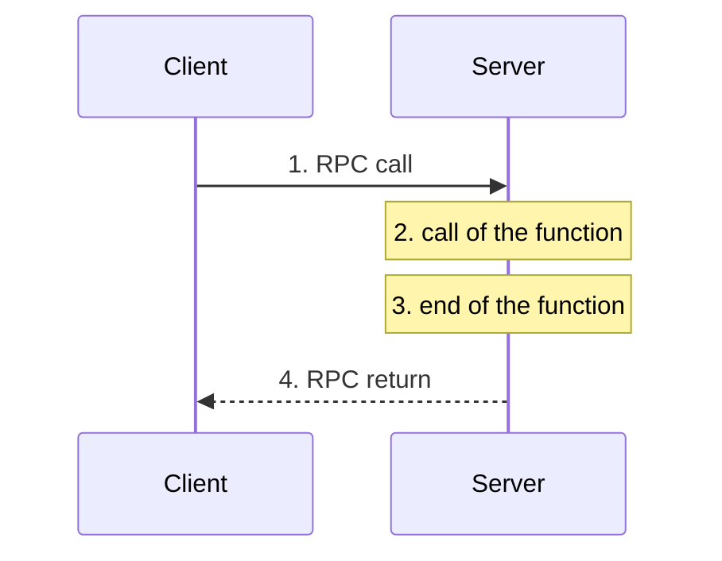

# Remote Invocation (RPC and RMI)

> [!definition]
> **Remote invocation** (*entfernter Aufruf*) is a **technique for realizing inter-process
> communication**. It **enables the calling of functions in other address spaces.**

*The four steps of a remote call. The client is blocked between 1 and 4.*

## Two flavours

> [!definition]
> **Remote Procedure Call (RPC):** call of **procedural functions** in other address spaces —
> **client programs call functions in server programs.**

> [!definition]
> **Remote Method Invocation (RMI):** call of **object-oriented methods** in other address
> spaces — **objects call methods of other objects** in another process or computer.

| | RPC | RMI |
|---|---|---|
| Unit of call | procedure | method **on an object** |
| Caller must additionally send | — | **which object** the method is called on |
| Parameters | values | values **and object references** |
| Needs | — | [[concepts/distributed-object-model]], [[concepts/rmi-registry]] |

## Differences from local calls

1. **Different computers means different address spaces.**
2. **Computers use different data structures** — hence
   [[concepts/external-data-representation]].
3. **Call and return occur over a communication network.**
4. **Failure situations** — see [[concepts/remote-call-failures]].

## The design goal, and its limit

Compared with the use of a local function:
- **the additional execution effort should be minimal**, and
- **in software-engineering terms, calls should not differ.**

**Remote calls are an emulation (*Nachbildung*) of local calls.**

> [!warning]
> **Not all aspects can be made transparent.**
>
> Concretely: **pointers cannot be passed** (addresses refer to different address spaces —
> see [[concepts/stubs-and-skeletons]]), failures have no local analogue, and
> [[concepts/call-semantics|exactly-once semantics is unachievable]].

## Interfaces

- Description of the offered functions/methods via an **interface description** —
  see [[concepts/interface-definition-language]].
- **Separation of interfaces and implementation**, which gives:
  - **information hiding**,
  - **minimized dependency between components**,
  - the **implementation can be swapped out without effect on other components.**

### Interfaces in distributed systems

- **Only methods and procedures — no direct variable access.**
- **Problem: pointers inside one process are invalid in other processes.**
- Host languages: **C header files, C++ classes, Java interfaces.**

> [!inference]
> "No direct variable access" is not a style preference: a variable access is a memory
> access, and memory does not cross the network. Every interaction must be expressible as a
> *message*, which is exactly what a procedure call can be encoded as and a field read cannot.

## Related
- [[concepts/stubs-and-skeletons]]
- [[concepts/external-data-representation]]
- [[concepts/interface-definition-language]]
- [[concepts/call-semantics]]
- [[concepts/distributed-object-model]]
- [[concepts/middleware]]
- [[concepts/proxy]]
- [[chapters/04-remote-invocation]]
