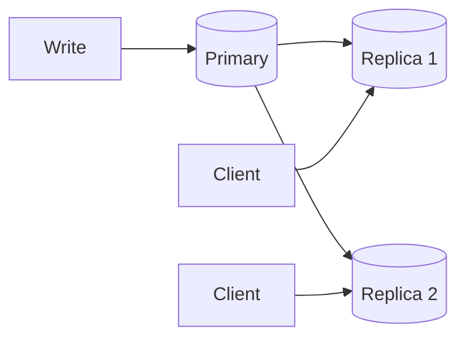

# Replication

> [!definition]
> **Replication** is the **multiple storage of the same data at different locations and
> their synchronization.**



## Synchronous vs. asynchronous replication

> [!definition]
> **Synchronous replication:** changes are **only successfully completed when they have been
> carried out on all replicas** — i.e. the **data are consistent at all times**.

> [!definition]
> **Asynchronous replication:** **time may pass between processing the primary and the
> replicated data** — i.e. the **data are not consistent at all times**.

```text
# synchronous
on write(x, v):
    for each replica r:
        send ⟨UPDATE, x, v⟩ to r
    wait for acknowledgement from every r      # blocking
    return COMMITTED

# asynchronous
on write(x, v):
    apply v at the primary
    return COMMITTED                            # client is released here
    propagate ⟨UPDATE, x, v⟩ to the replicas in the background
```

**Assumptions:** a known, finite set of replicas; reliable delivery of updates.
**Message complexity:** *k* update messages for *k* replicas; synchronous additionally needs
*k* acknowledgements ⇒ 2*k*.
**Time complexity:** synchronous ≥ the slowest replica's round trip; asynchronous ≈ the
primary's local write.
**Failure behaviour:** synchronous **blocks or fails** if any replica is unreachable —
the same blocking weakness as [[algorithms/two-phase-commit]]. Asynchronous stays available
but serves stale reads, and updates in flight can be lost if the primary crashes.

| | Synchronous | Asynchronous |
|---|---|---|
| Consistency | always | eventually |
| Write latency | slowest replica | primary only |
| Availability under replica failure | low | high |

> [!inference]
> This is the availability/consistency trade-off that the rest of the course formalizes. The
> module introduces it here informally, in the plainest possible terms: you may have
> consistent data or fast available writes, and the choice is made at replication time.

## Replication vs. distribution

The **difference from distributed data is the preservation of consistency on writing
accesses.** Splitting data creates no consistency problem (each item lives in one place);
copying data creates one with every write. See [[concepts/distribution-server]].

## When replication pays off

From task 3.7 in [[exercises/ex03-architectures-and-http]]: a document of *s* bytes requested
*r* times per second, replicated to *k* servers and updated *w* times per second, with a
replica near every requester:

```text
cost_without_replication = s · r        # every request crosses the network
cost_with_replication    = s · k · w    # only the updates cross the network

replication is cheaper  ⟺  s·r > s·k·w  ⟺  r > k·w
```

> [!exam]
> **Replication pays off exactly when the read rate exceeds the total update traffic,
> *r* > *k*·*w*.** The document size *s* cancels out — it never matters.

## Related
- [[concepts/distribution-server]]
- [[concepts/scalability]]
- [[concepts/transparency]]
- [[algorithms/two-phase-commit]]
- [[concepts/middleware]]
- [[exercises/ex03-architectures-and-http]]
- [[concepts/file-caching-and-replication]]
- [[concepts/distributed-file-system]]
- [[chapters/03-architectures-and-web-systems]]
