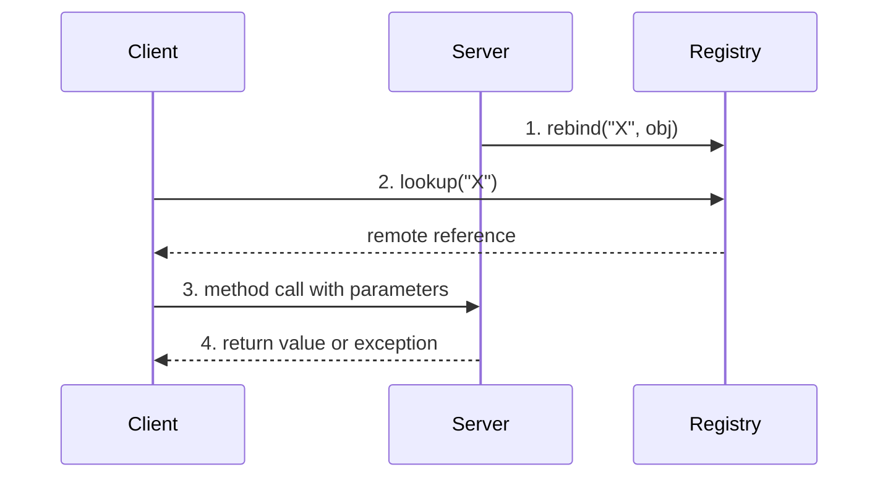

# Registry and Naming Service

> [!definition]
> A **naming service (registry)** is a **service that binds objects to an unambiguous name.**
> The **server registers an object with the naming service.**

It solves the bootstrap problem created by
[[concepts/distributed-object-model|"to call a method of a remote object, a reference must
exist"]]: the registry is where the *first* reference comes from.

## Interplay of client, server and registry

- The **server provides remote objects with their implementation**; **methods are executed on
  the server.**
- The **server stub forwards incoming calls from the network to the referenced object and
  executes the method.**
- The **client asks the naming service for the remote reference and calls the method.**



```text
# server
reg ← getRegistry(host, port)
reg.bind("X", obj)

# client
reg ← getRegistry(host, port)
obj ← reg.lookup("X")
obj.method()                    # from here on it looks like a local call
```

> [!theorem]
> **Methods can return remote references. Therefore not all objects need to be registered in
> the registry.**

> [!inference]
> The registry is only a **bootstrap**, not a directory of everything. One registered
> entry point is enough: in the address-list example **only the list must be registered**,
> and every individual `Address` object is reached through a reference returned by one of
> its methods. This keeps the registry small and the naming flat.

## The RMI registry concretely

- The registry is an **independent service** which can be started in **two ways**:
  - **from the server itself**, with `LocateRegistry.createRegistry()`,
  - via the **external service program `rmiregistry`**.
- It performs the **management of a table of remote objects on that machine.**

### Addressing

```text
rmi://hostname:port/objectname
```

| Element | Default |
|---|---|
| protocol | `rmi` |
| host | `localhost` |
| port | **`1099`** |

### Access via `java.rmi.Naming`

```java
public static void     bind(String name, Remote obj);
public static void     rebind(String name, Remote obj);
public static Remote   lookup(String name);
public static void     unbind(String name);
public static String[] list(String name);
```

**All of them throw** `RemoteException`, `AccessException`, `NotBoundException`,
`MalformedURLException`.

> [!exam]
> `bind` fails if the name is already taken; `rebind` **overwrites** it. Server code
> normally uses `rebind` so that a restart does not collide with its own stale entry.

> [!inference]
> The registry is the "naming service" that [[concepts/middleware]] listed among the
> services middleware provides, and that frameworks list under
> [[concepts/libraries-frameworks-and-containers|lifecycle management]]. It is also a
> [[concepts/distribution-server|single point of failure]] in the same sense a distribution
> server is — but a milder one, since it is consulted only once per client.

## Related
- [[models/java-rmi]]
- [[concepts/distributed-object-model]]
- [[concepts/middleware]]
- [[concepts/distribution-server]]
- [[exercises/ex04-rpc-rmi-and-ber]]
- [[chapters/04-remote-invocation]]
