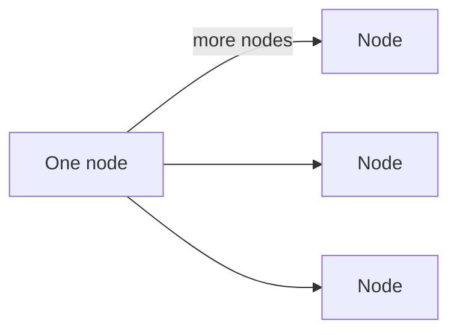
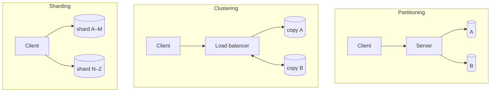

# Scalability

Scalability describes whether a system can keep up when demand on it changes.

> [!definition]
> **Scalability** (*Skalierbarkeit*) describes the ability of a system to **adapt to changing
> demands on its performance**.

- *Well scalable*: 1 server serves 20 users → 2 servers serve 40 users.
- *Poorly scalable*: for double the cost, ten times the resources are already required.

The quantitative measure is the [[concepts/speedup|scaling factor]].

## Vertical scaling

> **Vertical scaling** (*vertikale Skalierung*): the **locally available resources are
> increased** — the machine is equipped with more powerful hardware.

- **Advantage:** as a rule, **no influence on the software architecture**.
- **Disadvantages:** vertical scaling is **often not linear**, and it **has limits**
  (there is a biggest available machine).

*Vertical scaling: one node grows.*

## Horizontal scaling

> **Horizontal scaling** (*horizontale Skalierung*): **new resources are attached over a
> network** and the load is distributed across several machines.

Example: instead of one server, deploy several, with one server acting as **load balancer**
for the others.

### Replication of the service

- **Precondition:** the application must be replicable.
- **Advantages:** load distribution, failure safety (*Ausfallsicherheit*).
- **Disadvantages:** dependence on network availability; higher security requirements.

*Horizontal scaling: more nodes.*

## Horizontal scaling of databases

| Technique | Definition |
|---|---|
| **Partitioning** (*Partitionierung*) | distribute the data set across several storage media |
| **Clustering** (*Clusterung*) | replication **and** load distribution |
| **Sharding** | individual servers are responsible for a **consistent data volume** |

*Three ways to spread a database over several machines. In clustering the replicas must
synchronize with each other — the cost modelled in
[[exercises/ex02-foundations-and-2pc]].*

> [!inference]
> Partitioning and sharding overlap in the summary. The distinguishing detail recorded is the
> **key range**: sharding assigns each server a contiguous, consistent slice of the key space
> (A–M, N–Z), whereas partitioning is only about spreading data over several storage media.

## Techniques for achieving scalability

- Split up and distribute the processing
- Replicate data
- Caching
- Load distribution (*Lastverteilung*)
- [[concepts/asynchronous-communication|Asynchronous communication]]
- Minimize resource conflicts
- Use **stateless components**
- Virtualization

> [!exam]
> Replication is a double-edged answer: it buys scalability and failure safety, but every
> replica must be synchronized with every other, which **costs throughput**. The exercise
> derives `f(n) = 10n(11 − n)` from exactly this trade-off — see
> [[exercises/ex02-foundations-and-2pc]].

## Worked examples
- [[exercises/ex02-foundations-and-2pc]] (tasks 2.1/4 and 2.2)

## Related
- [[concepts/speedup]]
- [[concepts/elasticity]]
- [[concepts/cloud-computing]]
- [[concepts/transparency]]
- [[concepts/performance-criteria]]
- [[concepts/distribution-server]]
- [[concepts/replication]]
- [[concepts/http-scalability]]
- [[chapters/02-foundations-of-distributed-systems]]
