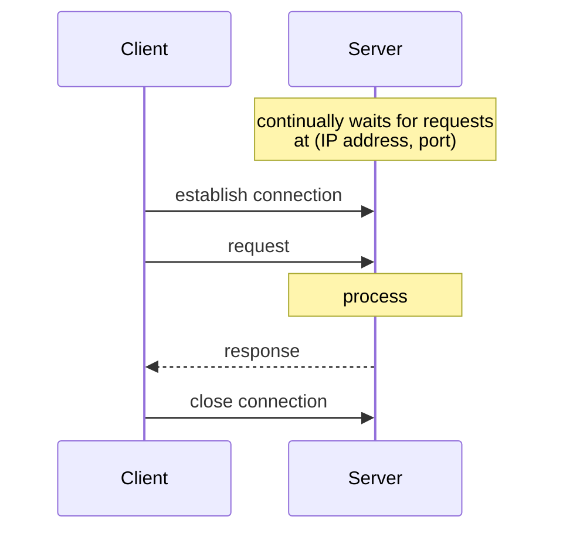

# Server and Client

> [!definition]
> A **server** is a **running program — i.e. a process — on a networked computer, which
> provides a service and continually waits for requests.** The operator of the service
> defines an **access point (IP address, port)** under which the service can be reached.

> [!definition]
> A **client** is a **requesting process on a networked computer that uses a service.**

Note that both are defined as **processes**, not machines. One computer can host many
servers and clients at once; see [[concepts/ip-addressing-and-ports]] for why the port is
what disambiguates them.

## The client–server architecture

- Realizes the **[[concepts/pull-and-push-style|pull style]]**.
- The **protocol governs the communication**: a **request/response protocol**.



### Request/response protocol — synchronous sequence

```text
1. The server continually waits for requests     (IP address, port)
2. The client establishes a connection to the server
3. The client sends the request and waits for the answer
4. The server receives the request, processes it, and sends the answer back
5. The client receives the answer and continues working
6. The client closes the connection
```

### Two open questions

| Question | Range of answers |
|---|---|
| **How does the client identify the server?** | known address … arbitrary names |
| **How is the request described?** | fixed requests … requests with parameters |

The first question is the subject of naming services; the second leads directly into
request encoding.

## Specifying the request

At the **TCP level a sequence of bytes is transmitted**. **Request and answer data must be
encoded so that the receiver can decode them unambiguously.**

> [!inference]
> This is the same problem as [[concepts/byte-order|byte order]] from Chapter 1, now raised
> from integers to whole structured requests. [[concepts/json]] and
> `application/x-www-form-urlencoded` (see [[concepts/http]]) are the two concrete answers
> this module gives.

## Related
- [[models/client-server-architecture]]
- [[concepts/interaction-types]]
- [[concepts/performance-criteria]]
- [[concepts/iterative-and-concurrent-servers]]
- [[concepts/sockets]]
- [[concepts/http]]
- [[chapters/03-architectures-and-web-systems]]
