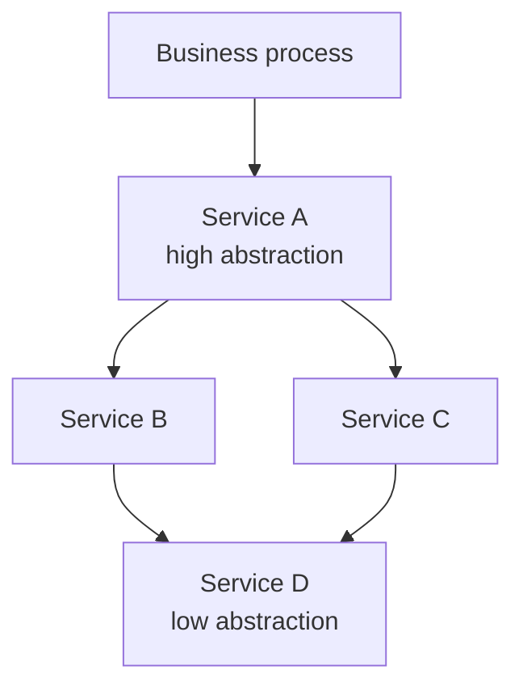

# Service-Oriented Architecture (SOA)

> [!definition]
> In a **service-oriented architecture** the system is divided **by functional aspect, not
> by data**. Business processes are split into **independent sub-flows — the services**.

## Orchestration

**Orchestration of services of a lower abstraction level creates services of a higher
abstraction level.**

*Services compose upward; each level is a reusable unit in its own right.*

## Advantages

- **High flexibility.**
- **High reusability.**
- **Services can be sourced externally** (bought in rather than built).

## Realization

- Realized as **web services via HTTP** — see [[concepts/http]].
- **Loose coupling via messages and events** instead of **tight coupling via remote function
  calls**.

| | Tight coupling | Loose coupling (SOA) |
|---|---|---|
| Mechanism | remote function call | message / event |
| Knowledge required | callee's interface signature | message format |
| Availability | callee must be up now | message can be stored |

> [!inference]
> The move from remote calls to messages is exactly the move from
> [[concepts/persistent-and-transient-communication|transient]] toward **persistent**
> communication, and from [[models/architectural-styles|object-based]] toward
> **event-based** styles. SOA is not a new mechanism so much as a consistent preference
> among the mechanisms already catalogued in this chapter.

## Related
- [[models/architectural-styles]]
- [[concepts/http]]
- [[concepts/persistent-and-transient-communication]]
- [[concepts/middleware]]
- [[chapters/03-architectures-and-web-systems]]
