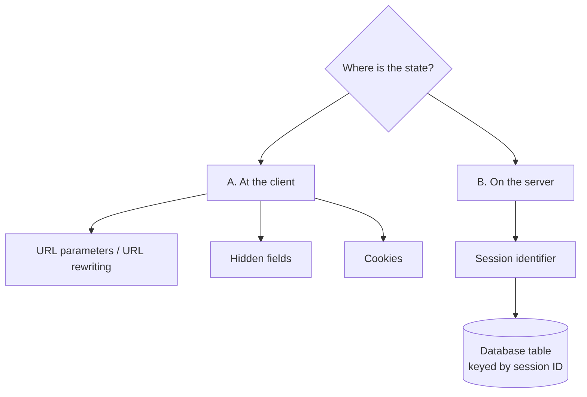
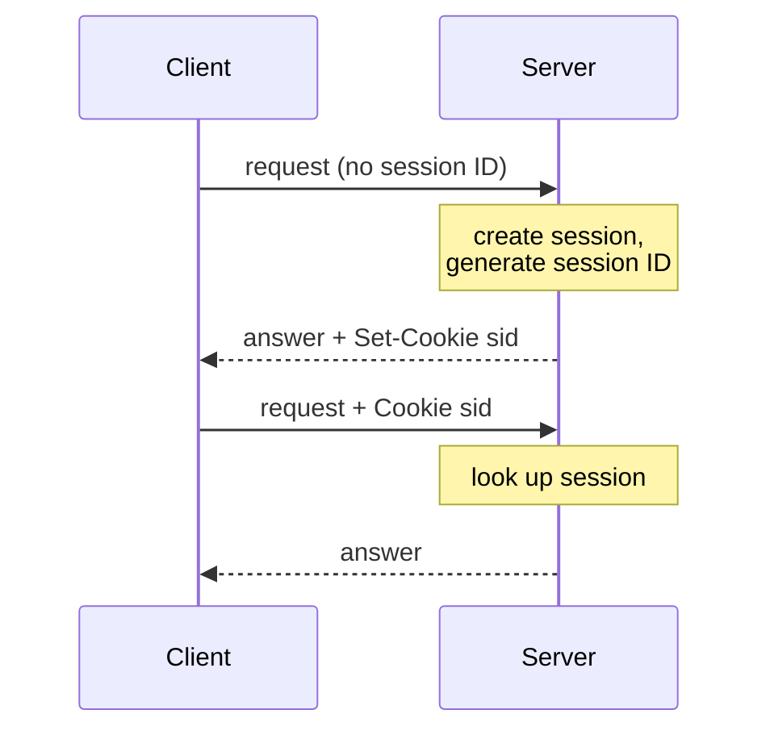

# Sessions and Statelessness

> [!definition]
> A **session** (*Sitzung*) **consists of a sequence of interactions between a client and a
> server.** The **state of a session is described by the state data.**

> [!definition]
> A protocol is **stateless** (*zustandslos*) if **several requests — even of the same
> client — are fundamentally independent of one another**, i.e. **requests are handled
> without reference to earlier requests and no state data are managed.**

> [!theorem]
> **HTTP is a stateless protocol.**

This is the tension the whole section resolves: web applications need sessions, but their
protocol has none.

## Where are the state data stored?



### A. Storage at the client

The **client sends all state data with every request to the server**; the **server
application updates the state data and sends them back with the answer.** The **server is
completely stateless.**

| | |
|---|---|
| **−** | the **client can change the data**; **possible data loss** |
| **+** | the **server can be restarted between requests** |

**How are the data transferred?**

- **URL parameters / URL rewriting** — the **server application appends the data to every URL
  in the answer**. *Disadvantage: the size of the data is limited.*
  ```text
  http://sf.de/req.jsp?isb=978-11-41&kaurell=1
  ```
- **Hidden fields** — the server application **writes the data into the answer document** as
  hidden fields in HTML form elements.
- **Cookies** — carried in an HTTP header.

> [!definition]
> A **cookie** is an **HTTP header** used to transfer data to and from the client. It stores
> e.g. the **session ID**, or is used generally for transferring data — it **stores the user
> state**.

### B. Storage on the server

The **server must assign incoming requests to the stored data.** A **session identifier
(session ID)** identifies the session.

- **Stateful protocols:** handled as part of the protocol.
- **Stateless protocols:** **the applications are responsible for it.**

```text
on request(r):
    if r has no session ID:
        sid ← generate_session_id()        # new session begins
        create_session(sid)
        attach sid to the answer           # usually via Set-Cookie
    else:
        s ← lookup_session(r.session_id)
        handle r in the context of s
```



**State data in a database:** the **session key is the key for a database table**; entries
are **deleted after a timeout.**

## Session IDs

- The session ID is **transferred with HTTP frequently via cookies**.
- **Session IDs must be hard to guess.** Normally, on the first request of a user, a
  **random number from a very large value range** is generated, assigned to them by the
  server, and sent by the client with every request.

> [!warning]
> **Privacy.** Session IDs **are used today for personalization**; **durable person
> identifiers are used as session IDs**, and browsers **store session IDs permanently**. **By
> passing on this knowledge to other companies, user profiles are created — privacy is
> endangered.**

### Anti-pattern: a pool of pre-generated random numbers

A developer who wants to avoid generating a random number for each new session, and instead
**lays out a pool of random numbers at system start**, creates:

- a **limited number of session IDs**,
- **brute force can simply find all SIDs**,
- the **privacy of the users is no longer safe**,
- **SIDs become easy to guess**,
- **even data of "old users" can be seen** (IDs get recycled),
- **DoS attacks** — an attacker can exhaust the pool.

> [!exam]
> The reasoning chain is: *finite pool ⇒ enumerable ⇒ guessable ⇒ session hijacking and
> exhaustion.* Session IDs must come from a large space **and** be freshly generated.

Worked as task 3.6 in [[exercises/ex03-architectures-and-http]].

## Related
- [[concepts/http]]
- [[concepts/fat-and-thin-clients]]
- [[concepts/libraries-frameworks-and-containers]]
- [[concepts/persistent-data-storage]]
- [[exercises/ex03-architectures-and-http]]
- [[concepts/stateless-and-stateful-servers]]
- [[chapters/03-architectures-and-web-systems]]
