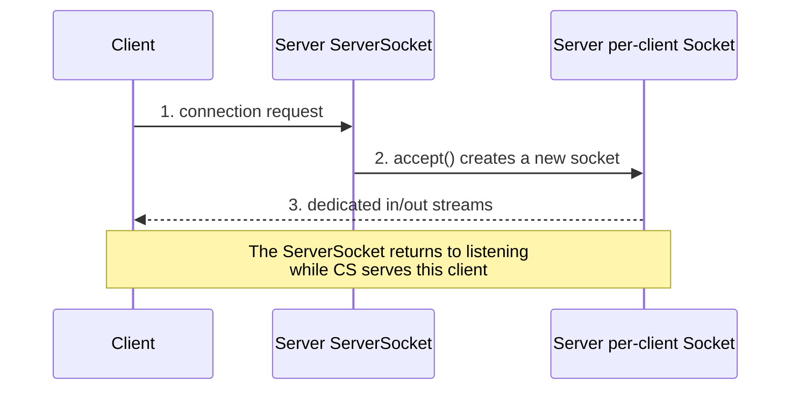

# Sockets

A socket is an object provided by the operating system that serves as a **communication
endpoint** for inter-process communication between processes on different machines.

> [!definition]
> **Sockets** are objects provided by the operating system which serve as communication
> endpoints (*Kommunikationsendpunkte*) for inter-process communication between processes on
> different computers.

- Each communication partner holds **one socket**.
- A socket is **bound to a port and an IP address** on the machine it runs on.

## Datagram sockets (UDP)

```text
# server
sock ← create_socket()
bind(sock, port)
loop:
    pkt ← receive(sock)          # blocks

# client
sock ← create_socket()
send(sock, datagram, ⟨server_ip, server_port⟩)
```

**Assumptions:** [[concepts/udp]] semantics — no connection, no reliability.
**Message complexity:** 1 per datagram.
**Time complexity:** one one-way latency.
**Failure behavior:** a lost datagram simply never arrives; `receive` blocks forever unless a
timeout is configured.

## Stream sockets (TCP)

```text
# server
srv ← create_server_socket()
bind(srv, ⟨ip, port⟩)                 # endpoint on which requests are accepted
loop:
    wait for a request
    client_sock ← accept(srv)         # NEW socket pair, dedicated to this client
    communicate over client_sock
    close(client_sock)

# client
sock ← create_socket(⟨server_ip, server_port⟩)   # creating it establishes the connection
communicate over sock
close(sock)
```

**Assumptions:** [[concepts/tcp]] semantics.
**Message complexity:** handshake + data segments + teardown.
**Time complexity:** at least one round trip before payload flows.
**Failure behavior:** TCP retransmits; an unreachable peer eventually raises an I/O error.


*The key asymmetry: `ServerSocket` only accepts; the socket returned by `accept()` does the
actual communication.*

## Java API — UDP

**`DatagramSocket`** — sends and receives datagrams.

| Member | Meaning |
|---|---|
| `DatagramSocket(int port)` | creates the socket and binds it to the given port of the local machine |
| `void send(DatagramPacket p)` | send a packet |
| `void receive(DatagramPacket p)` | receive a packet (blocking) |

**`DatagramPacket`** — represents a single packet consisting of a byte sequence. Every
datagram carries a **destination address and destination port**.

| Member | Meaning |
|---|---|
| `DatagramPacket(byte[] buf, int length, InetAddress address, int port)` | packet for sending |
| `DatagramPacket(byte[] buf, int length)` | packet for receiving |
| `byte[] getData()` | payload |
| `InetAddress getAddress()` | sender/destination address |
| `int getPort()` | sender/destination port |

Echo server, as recorded in the summary:

```java
public static void main(String[] args) throws ... {
    DatagramSocket aSocket = new DatagramSocket(port);
    byte[] buffer = new byte[BUFFER_SIZE];
    while (true) {
        DatagramPacket request = new DatagramPacket(buffer, buffer.length);
        aSocket.receive(request);
        print(new String(request.getData(), 0, request.getLength()));
        DatagramPacket reply = new DatagramPacket(
                request.getData(), request.getLength(),
                request.getAddress(), request.getPort());
        aSocket.send(reply);
    }
    aSocket.close();
}
```

## Java API — TCP

**`ServerSocket`** — the endpoint of a communication that accepts requests and then creates
the socket for the actual communication.

| Member | Meaning |
|---|---|
| `ServerSocket(int port)` | listen on `port` |
| `Socket accept()` | block until a request arrives, return a new per-client socket |

**`Socket`** — the communication endpoint for clients.

| Member | Meaning |
|---|---|
| `Socket(InetAddress address, int port)` | creates the socket **and establishes the connection** |
| `InputStream getInputStream()` | read side |
| `OutputStream getOutputStream()` | write side |

```java
public class TCPServer {
    public static void main(String[] args) throws ... {
        ServerSocket servSock = new ServerSocket(port);
        while (true) {
            Socket clientSocket = servSock.accept();
            DataInputStream  in  = new DataInputStream(clientSocket.getInputStream());
            DataOutputStream out = new DataOutputStream(clientSocket.getOutputStream());
            String data = in.readUTF();
            out.writeUTF(data);
            clientSocket.close();
        }
    }
}
```

> [!warning]
> The source writes `String data = in.read(); out.write(data);`. **That does not compile.**
> `DataInputStream.read()` returns an `int` — a single byte, or `-1` at end of stream — not
> a `String`. The snippet above uses `readUTF()` / `writeUTF()`, the `DataStream` pair that
> actually transfers a whole string. The lecture's version is shorthand for "read a message,
> echo it back"; reproduce the *structure* in an exam, not the literal method names.

## Useful socket options

| Method | Purpose |
|---|---|
| `setSoTimeout(int timeout)` | enables `SO_TIMEOUT`: sets a timeout on blocking socket operations, so a `receive`/`read` cannot block forever |
| `setSendBufferSize(int)` / `setReceiveBufferSize(int)` | set the size of the I/O buffers |
| `isBound()` | returns the **binding** state of the socket — still `true` after the socket is closed |
| `isConnected()` | returns the **connection** state of the socket |

> [!exam]
> `isBound()` and `isConnected()` remain meaningful after `close()`: they report the state the
> socket *was* in, so they stay `true`. Also: with TCP the application **never sends ACKs
> itself** — this happens automatically.

## Sockets in C/C++ (practical)

Portable code selects the header set at compile time:

```text
if WIN32:  #include <winsock2.h>      # link against ws2_32
else:      #include <sys/socket.h>
           #include <arpa/inet.h>
           #include <unistd.h>
```

Windows-specific startup sequence:

| Symbol | Meaning |
|---|---|
| `WSADATA` | structure containing information about the Windows socket implementation |
| `WSAStartup` | initializes use of the Winsock DLL by a process |
| `socket(af, type, protocol)` | creates a socket bound to a specific transport service provider |
| `connect` | connects the socket to a peer |

See also [[concepts/byte-order]] — C-level socket code must convert integers to network byte
order explicitly.

## Worked examples
- [[exercises/ex01-tcp-udp-and-sockets]] (task 1.3)

## Related
- [[concepts/tcp]]
- [[concepts/udp]]
- [[concepts/ip-addressing-and-ports]]
- [[concepts/application-protocol]]
- [[models/client-server-architecture]]
- [[chapters/01-networking-and-sockets]]
