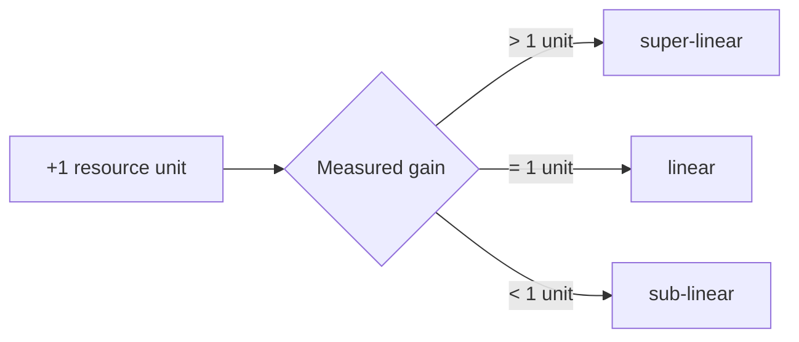

# Speedup (Scaling Factor)

The scaling factor quantifies what an extra unit of resource actually buys.

> [!definition]
> The **scaling factor** (*Skalierungsfaktor*, **speed-up**) states the **actual performance
> gain of one additional resource unit**.

## The three regimes

| Regime | Meaning |
|---|---|
| **Super-linear** | the gain exceeds the added resources |
| **Linear** | the gain is proportional to the added resources — the ideal case |
| **Sub-linear** | the gain falls short of the added resources — the normal case |


*Classification of the measured gain per added resource unit.*

```text
# definition used in the module
speedup(n) ≔ performance(n) / performance(1)

classify(n):
    if speedup(n) > n:  return "super-linear"
    if speedup(n) = n:  return "linear"
    else:               return "sub-linear"
```

> [!inference]
> Sub-linear behaviour is the default because added nodes must coordinate with the existing
> ones. The replicated-file-server exercise makes this concrete: throughput
> `f(n) = 10n(11 − n)` is sub-linear from the start and eventually turns **negative in slope**,
> peaking at n = 6 and reaching zero at n = 11. See
> [[exercises/ex02-foundations-and-2pc]].

> [!exam]
> Note the asymmetry with [[concepts/scalability]]: vertical scaling is explicitly described
> as "often not linear", so do not assume linear speed-up for a bigger machine either.

## Worked examples
- [[exercises/ex02-foundations-and-2pc]] (task 2.2)

## Related
- [[concepts/scalability]]
- [[concepts/elasticity]]
- [[chapters/02-foundations-of-distributed-systems]]
