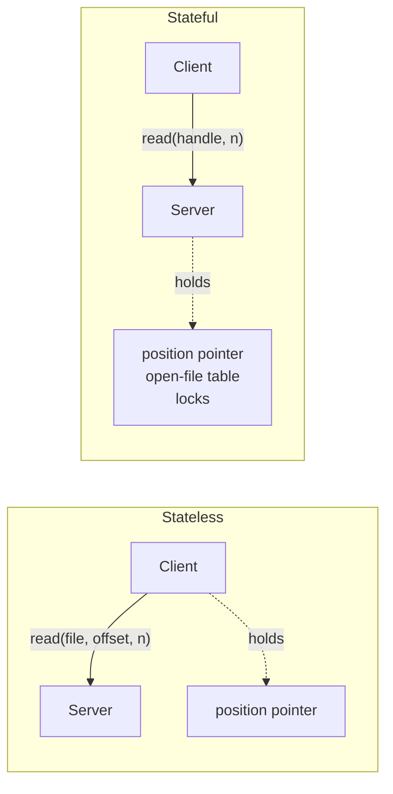

# Stateless and Stateful File Servers

*Zustandslose und zustandsbehaftete Dateiserver.* The question is **who remembers what is
currently going on**.

## What counts as state information

The summary poses it as two questions:

- **which files are opened by which client**, and **where does the position pointer
  (*Positionszeiger*) of a file stand?**
- **who manages the state information — client or server?**

> [!inference]
> The second question is the real one. The state *exists* either way; "stateless server"
> never means "no state", it means **the state has been pushed to the client and is carried
> in every request**. This is the same move [[concepts/sessions-and-statelessness|HTTP]]
> makes, and it has the same consequence: bigger messages in exchange for a server that can
> be restarted, replaced or load-balanced freely.

## Advantages of a stateless file server

- **needs no memory for state**
- **operations for opening/closing files are unnecessary**
- **fault tolerance is easy to realize, because no state information has to be synchronized
  between the servers**
- **when a client crashes, no problems arise for the servers, because no orphaned
  information exists**

## Advantages of a stateful file server

- **messages are smaller, because no state data has to be transmitted with every access**
- **write and read accesses are more efficient**, because for example the position pointer
  of a file currently being accessed **already stands in the right place**
- **prefetching on the server is possible, because all files currently being accessed are
  known**
- **file locks can be supported by the server**
- **POSIX is stateful**

## Side by side

| | Stateless | Stateful |
|---|---|---|
| Memory for state | none | per open file |
| `open` / `close` | unnecessary | required |
| Message size | larger (state travels) | smaller |
| Access efficiency | lower | higher (pointer in place, prefetching) |
| File locks | not supported by the server | supported |
| Server crash | client just retries | state lost, recovery needed |
| Client crash | nothing to clean up | orphaned state on the server |
| Replication / fail-over | easy, nothing to synchronize | state must be synchronized |

> [!inference]
> The two lists are not two opinions, they are **one trade read from both ends**: every
> stateless advantage is a statement about *failure*, every stateful advantage is a
> statement about *performance*. That is the recurring shape of this whole course — compare
> [[concepts/file-access-semantics]], where the same trade appears as latency vs. copies.

> [!exam]
> The sharpest single point: a stateless server is **fault-tolerant for free** because
> there is nothing to synchronize between replicas. That is why it composes with
> [[concepts/replication]] and a [[concepts/distribution-server|load balancer]] and a
> stateful one does not.

> [!contradiction]
> **POSIX is stateful** — `open` returns a descriptor that carries a position pointer. So a
> distributed file system that wants to be POSIX-compatible (the
> [[concepts/distributed-file-system|"emulate a local file system"]] goal) cannot simply
> choose the stateless design. [[models/nfs|NFS]] resolves this by being stateless on the
> wire while the **client** reconstructs the POSIX state locally.

## Related
- [[concepts/distributed-file-system]]
- [[concepts/sessions-and-statelessness]]
- [[concepts/file-access-semantics]]
- [[models/nfs]]
- [[concepts/replication]]
- [[chapters/05-distributed-resources-and-synchronization]]
