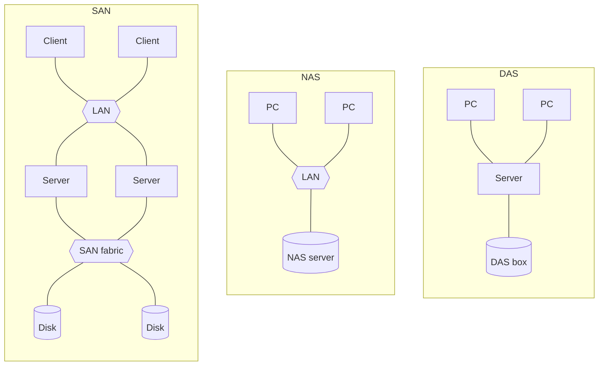

# Storage Architectures — DAS, NAS and SAN

Below the [[concepts/distributed-file-system|file-system]] question sits a hardware
question: **how are the disks attached?** Three answers, distinguished above all by
*block-wise vs. file-based access*.

## Direct Attached Storage (DAS)

- **hard disks attached to an individual computer or server; point-to-point connection**
- **interface: SCSI** (the exercise notes it as a *serial interface*)
- **other computers can only access via the access computer** (*Zugangsrechner*)
- **limited capacity**
- **access: block-wise**
- **the file system is managed by the access computer**

## Network Attached Storage (NAS)

- **storage that is attached to a network**
- **an autonomous server service that provides file systems to the clients attached via the
  LAN**
- **the hard disks are bound to a small server**
- **access: file-based — NFS**
- **large volumes of data, low energy consumption**
- **easy to administer**

## Storage Area Network (SAN)

- **a network for fast attachment of disk systems to server systems; many-to-many
  connection**
- **several storage systems can be attached to several servers**
- **large volumes of data**
- **data access is block-wise; the file system is managed by the accessing computer**
- **attachment: a high-performance network close to the I/O bus of the computers**
- **simple central administration**
- **backup outside the LAN**
- **the SAN presents itself to the LAN as a coherent mass storage, although the SAN may
  consist of many small storages**
- **a SAN is optimal for fast data transfer between individual storages and servers**

## NAS vs. SAN

| | SAN | DAS | NAS |
|---|---|---|---|
| **Data access** | block-wise | block-wise | **file-based** |
| **Who manages the file system** | the accessing computer | the access computer | the NAS server |
| **Backup** | **taken over by the server** | **taken over by the server** | **another computer must take this over** |
| **Topology** | many-to-many | point-to-point | via the LAN |

> [!inference]
> The whole table follows from one choice. **Block-wise access means the storage does not
> know what a file is**, so somebody else must own the file system and therefore also the
> backup — which is why SAN and DAS both put backup on the server. NAS owns the file system
> itself, which is what makes it easy to administer *and* what makes its backup somebody
> else's problem. One decision, every row.

## Virtualization of disk subsystems

A SAN enables it:

- **the distributed available mass storage is treated virtually as a single hard disk**
- **individual servers are assigned partitions on the virtual hard disk, which the servers
  mount as their own hard disk**
- **advantage: the available storage space can be used more effectively and administered
  centrally**
- **the size of the reserved storage area can be changed during operation**

> [!inference]
> This is the storage instance of the general pattern on
> [[concepts/virtualization]] — interpose a software layer, multiplex one physical
> resource into many logical ones, and gain the ability to resize at runtime. The phrase
> *"changed during operation"* is the payoff in both cases, and it is what
> [[concepts/elasticity|elasticity]] is built from.

## Cloud storage systems

- **storage of the data on storage systems at cloud providers**
- **access via the internet**
- **synchronization of the files and folders between the local hard disk and the cloud
  storage**
- **simple version control**

> [!inference]
> Note which access semantics cloud storage picked: local copy plus synchronization plus
> version control is **upload/download (session) semantics** from
> [[concepts/file-access-semantics]], including its inherited versioning problem — which is
> precisely why every consumer cloud-storage product has a "conflicted copy" feature.

> [!exam]
> The one-line discriminator: **DAS = disks behind one computer, NAS = a file server on the
> LAN, SAN = a separate high-speed network of disks shared by many servers.** Then add
> *block vs. file* and the backup consequence.

## Related
- [[concepts/distributed-file-system]]
- [[concepts/virtualization]]
- [[concepts/cloud-computing]]
- [[concepts/cloud-service-models]]
- [[models/nfs]]
- [[exercises/ex05-storage-and-clock-synchronization]]
- [[chapters/05-distributed-resources-and-synchronization]]
