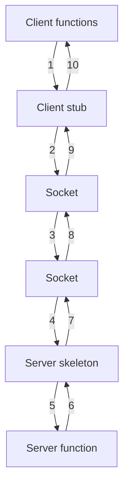
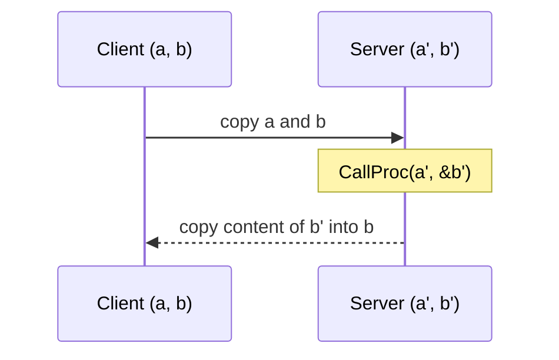

# Stubs and Skeletons

## Code generation

- A **tool generates code for the remote call.**
- The generated code parts are called **stubs** or **skeletons**.

> [!definition]
> **Stubs are local procedures which are generated from the actual procedure by a tool.**

- **Middleware supports the execution of the generated code.**

## The layering


*Ten steps. The client function and the server function are the only hand-written parts.*

### Client stub

- **Is a [[concepts/proxy|proxy]]** — i.e. it has the **same interface as the remote
  procedure**.
- **Controls the transmission protocol.**
- **Marshals and packs the parameters into a message.**
- **Sends the message, waits for the answer and unpacks it.**

```text
# generated client stub
function f(args):
    conn ← connect(server_address)
    msg  ← marshal(⟨"f", args⟩)
    send(conn, msg)
    reply ← receive(conn)            # blocking
    return unmarshal(reply)
```

### Server skeleton

- **Waits for requests.**
- **Unpacks the parameters, calls the local procedure, packs the return value into a message
  and sends it.**

```text
# generated server skeleton
loop forever:
    msg ← receive()
    ⟨name, args⟩ ← unmarshal(msg)
    result ← local_procedure[name](args)
    send(marshal(result))
```

**Minimum the client must send:** the **function name** and the **parameters**.
**What the server sends back exclusively:** the **return value**.

> [!inference]
> Even for a `void` function a response is worth sending, so that the client knows the call
> was carried out successfully — and so that an **exception** can be reported at all. A
> genuinely reply-free call is [[concepts/interaction-types|one-way communication]], and it
> gives up all delivery guarantees.

## A hand-written stub (what the generator replaces)

```c
double kleinsterEigenwert(double m[][], int n) {
    struct sockaddr_in server;
    unsigned long addr = inet_addr(host);
    memcpy((char*) &server.sin_addr, &addr, /* ... */);
    server.sin_port = htons(port);
    /* ... */
    if (connect(socket, (struct sockaddr*) &server, /* ... */) < 0) {
        /* error */
    }
    // send m and n
    // receive the result
    return eigenvalue;
}
```

The remote declaration is just `double kleinsterEigenwert(double m[][], int n)` — identical
to the local one. That identity is the whole point.

## Handling of pointer types

> [!warning]
> **Call-by-reference cannot be used with RPCs, because addresses refer to different address
> spaces.**

**Solution: call-by-copy/restore.**

- **On call:** transmission as with call-by-value.
- **After termination:** **copy back to the client and overwrite the old values.**



```text
# call-by-copy/restore for Proc(a, &b)
send ⟨a, b⟩ to the server
server executes Proc(a', &b')  on its own copies
server returns b'
client: b ← b'                 # overwrite the old value
```

> [!exam]
> Copy/restore is **not equivalent** to by-reference. If two parameters alias the same
> variable, or the caller reads `b` concurrently, the results diverge. This is one of the
> aspects that **cannot be made transparent** — see [[concepts/remote-invocation]].

## Related
- [[concepts/remote-invocation]]
- [[concepts/interface-definition-language]]
- [[concepts/external-data-representation]]
- [[concepts/proxy]]
- [[models/java-rmi]]
- [[concepts/sockets]]
- [[exercises/ex04-rpc-rmi-and-ber]]
- [[chapters/04-remote-invocation]]
