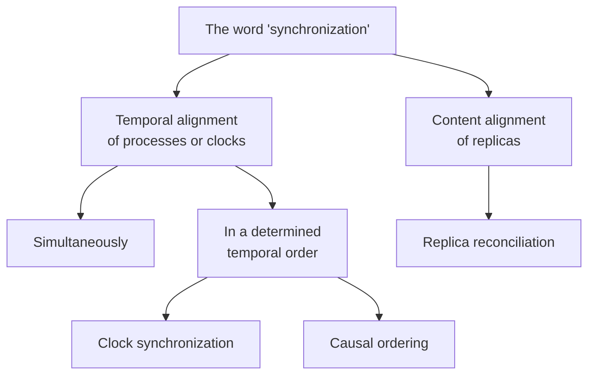

# Synchronization

The word is used in two different senses in this course, and the summary separates them
deliberately.

> [!definition]
> **Synchronization** (*Synchronization*) denotes the **temporal alignment of processes or
> clocks.**
>
> Synchronization ensures that processes run
> - **simultaneously**, or
> - **ordered in a determined temporal sequence.**

> [!definition]
> **Synchronizing** (*Synchronisieren*) is the **alignment of replicas with respect to
> content.**

Examples given: **process synchronization, alignment of clocks, causal ordering of
events.**

> [!inference]
> The distinction is worth holding on to because the **first half of this chapter was
> entirely about the second meaning**. "Synchronization of the files between the local hard
> disk and the cloud storage", the voting procedure in
> [[concepts/file-caching-and-replication]], the invalidate/update messages — all of that is
> *Synchronisieren*, content alignment. The second half of the chapter is about
> *Synchronisation*, temporal alignment. The two meet in the observation that **you cannot
> reconcile replicas without knowing which version came first**, which is the problem
> [[concepts/causality]] solves.

> [!inference]
> Note which of the two sub-goals the rest of the chapter pursues. *Simultaneously* needs
> real time and leads to [[concepts/clock-synchronization]];
> *ordered in a determined sequence* needs only order and leads to
> [[algorithms/lamport-timestamps]]. The second is both cheaper and achievable exactly —
> which is the chapter's punchline.

## Related
- [[concepts/clock-correctness]]
- [[concepts/clock-synchronization]]
- [[concepts/causality]]
- [[concepts/file-caching-and-replication]]
- [[concepts/synchronous-communication]]
- [[chapters/05-distributed-resources-and-synchronization]]
