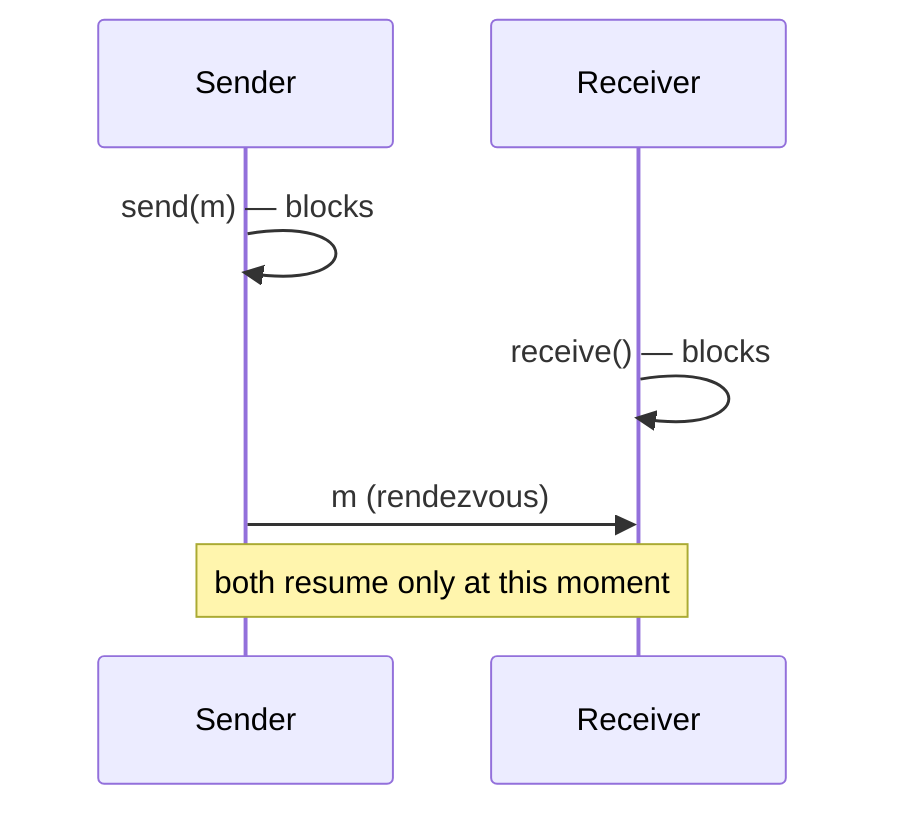

# Synchronous Communication

Synchronous communication couples sender and receiver in time: neither proceeds until the
other is ready.

> [!definition]
> **Synchronous communication** (*synchrone Kommunikation*) is the form of communication in
> which the sending and the receiving process are **synchronized**. Both **sending and
> receiving are blocking operations** ([[concepts/blocking-function]]).

## Protocol sketch

```text
# sender p_i
on send(m) to p_j:
    block until p_j is ready to receive
    transfer m
    resume                        # m has demonstrably been taken by p_j

# receiver p_j
on receive() from p_i:
    block until p_i offers a message
    return m
```

**Assumptions:** no buffering in the communication system; both partners must be present.
**Message complexity:** 1 message, no buffer management.
**Time complexity:** the slower of the two partners determines progress — a rendezvous.
**Failure behavior:** if one partner is not ready, the other blocks **permanently**.


*Sender and receiver meet at a rendezvous point.*

## Advantages

- **No mechanisms for temporal synchronization are necessary** — the rendezvous *is* the
  synchronization.
- **No buffering of messages is necessary.**
- Saves **memory and administrative overhead**.

## Disadvantages

- **Restricts parallelism** (*schränkt Parallelität ein*).
- If sender or receiver is not ready, the corresponding partner is **blocked permanently**.

## Related
- [[concepts/asynchronous-communication]]
- [[concepts/blocking-function]]
- [[concepts/communication-paradigms]]
- [[concepts/synchronization]]
- [[chapters/02-foundations-of-distributed-systems]]
