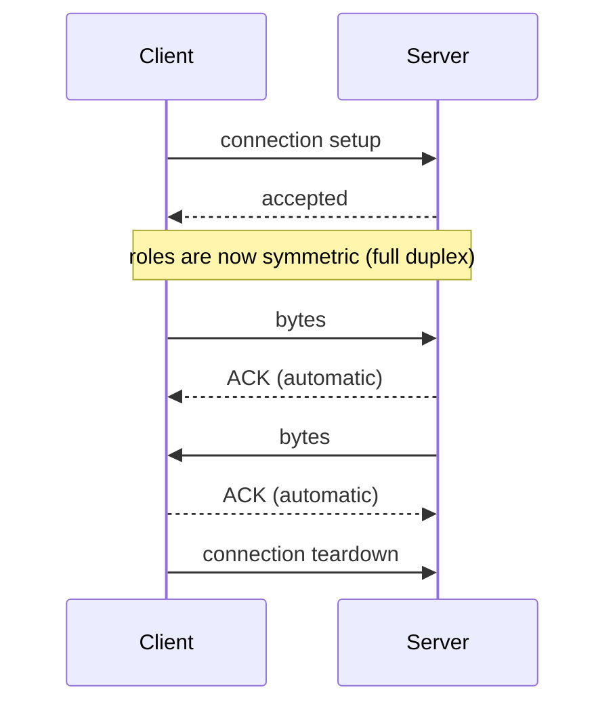

# TCP — Transmission Control Protocol

TCP provides the abstraction of a reliable, ordered **byte stream** between two endpoints.
Data is written into the stream at one end and read out at the other; the protocol hides
loss, duplication and reordering.

## Characteristics

- Provides the abstraction of a **byte stream** (*Byte-Strom*) that data is written into and
  read out of.
- TCP connections are **full-duplex**: both sides may send and receive simultaneously.
- Connection-oriented lifecycle: **connection setup → communication → connection teardown**.
- After connection setup there is **no difference between client and server** — the roles are
  symmetric; the asymmetry exists only during establishment.

## Guarantees

| Property | TCP |
|---|---|
| Duplicate detection | ✓ |
| Ordering preserved | ✓ |
| No packet loss | ✓ |

## Protocol sketch

```text
# TCP, from the application's point of view
state: conn ← ⊥

on connect(⟨ip, port⟩):              # client side
    conn ← handshake with ⟨ip, port⟩
    # after this point the roles are symmetric

on write(bytes):
    append bytes to conn.out_stream   # may block if the send window is full

on read(n):
    block until ≥ 1 byte available
    return up to n bytes from conn.in_stream
    # message boundaries are NOT preserved

on close():
    teardown conn
```

**Assumptions:** an unreliable network beneath; TCP itself maintains per-connection state on
both endpoints.
**Message complexity:** connection setup and teardown cost extra round trips on top of the
data; every data segment is acknowledged.
**Time complexity:** at least one round trip before any payload can flow.
**Failure behavior:** lost segments are retransmitted automatically; a peer that disappears
is eventually reported as a broken connection.


*TCP lifecycle. Acknowledgements are handled by the protocol, never by the application.*

> [!exam]
> Frequent traps, all **false**:
> - "With TCP all packets take the same route; with UDP they may take different routes."
>   Routing is an IP-layer decision and is independent of the transport protocol.
> - "TCP packets are always larger than UDP packets."
> - "The application must check for duplicates itself." — TCP already does this.
> - "IP packets are delivered to the application in the order the IP layer received them."
>   TCP reorders them into the *sent* order.

## When to use TCP

Long-lived connections, few connections, where reliability matters more than latency:
terminals, FTP, HTTP. See the full decision table in
[[exercises/ex01-tcp-udp-and-sockets]].

## Worked examples
- [[exercises/ex01-tcp-udp-and-sockets]]

## Related
- [[concepts/udp]]
- [[concepts/sockets]]
- [[concepts/ip-addressing-and-ports]]
- [[chapters/01-networking-and-sockets]]
