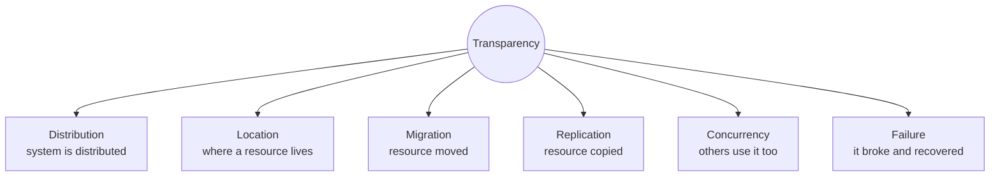

# Transparency

Transparency is what makes a distributed system *appear as a single coherent system* — the
third clause of the definition in [[concepts/distributed-system]].

> [!definition]
> **Transparency** (*Transparenz*) is a part of a system that is present and in operation, but
> otherwise **invisible** and **not perceived by the user as being present**.

Note the counter-intuitive terminology: a *transparent* component is one you cannot see.

## The six dimensions

| Transparency | Hides |
|---|---|
| **Distribution transparency** (*Verteilungstransparenz*) | the distributedness of the system itself |
| **Location transparency** (*Ortstransparenz*) | the storage location of a resource — unknown to the user |
| **Migration transparency** (*Migrationstransparenz*) | the change of position of resources |
| **Replication transparency** (*Replikationstransparenz*) | that the system replicates resources |
| **Concurrency transparency** (*Nebenläufigkeitstransparenz*) | the simultaneous use of resources by others |
| **Failure transparency** (*Ausfalltransparenz*) | the failure and recovery of a resource |

*Each dimension names one fact about the system that the user must not have to care about.*

> [!inference]
> The dimensions are not independent: replication transparency presupposes failure and
> concurrency transparency, because replicas exist precisely to survive failures and to serve
> concurrent load. The summary lists them flat and does not rank them.

> [!exam]
> Transparency and [[concepts/scalability]] are regularly asked together — define both, then
> note that they pull against each other: replication buys scalability but creates a
> consistency problem the system must then hide.

## Worked examples
- [[exercises/ex02-foundations-and-2pc]] (task 2.1/4)

## Related
- [[concepts/distributed-system]]
- [[concepts/scalability]]
- [[concepts/cloud-computing]]
- [[concepts/middleware]]
- [[concepts/distribution-server]]
- [[concepts/proxy]]
- [[concepts/remote-invocation]]
- [[chapters/02-foundations-of-distributed-systems]]
