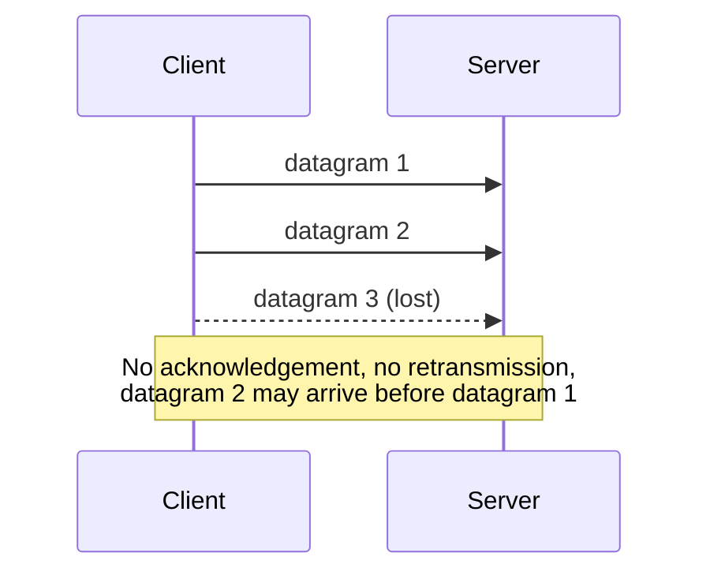

# UDP — User Datagram Protocol

UDP is the **connectionless, datagram-oriented** transport protocol: it hands an independent
byte array to the network and makes no promises about whether, when, or in what order it
arrives.

## Characteristics

- **Datagram-oriented**: data is sent as a **byte array**, not a stream.
- The **Maximum Transmission Unit (MTU)** bounds the payload size of one datagram.
- The **application** is responsible for splitting data across multiple datagrams.

## Service guarantees (or lack of them)

| Property | UDP |
|---|---|
| Protection against loss and corruption | ✗ none |
| Guaranteed ordering | ✗ none |
| Acknowledgements | ✗ none |
| Administrative overhead | very low |

## Protocol sketch

```text
# UDP, sender side
on send(data, ⟨ip, port⟩):
    assert len(data) ≤ MTU          # application must fragment itself
    transmit ⟨data, ip, port⟩       # fire and forget — no state kept

# UDP, receiver side
on receive():
    block until a datagram arrives
    return ⟨data, sender_ip, sender_port⟩
```

**Assumptions:** unreliable network; no connection state on either side.
**Message complexity:** 1 message per datagram (no acknowledgements).
**Time complexity:** one one-way network latency; no handshake.
**Failure behavior:** lost, duplicated, reordered or corrupted datagrams are not detected
and not repaired — the application must cope.


*UDP makes no effort to recover a lost datagram.*

## When to use UDP

Use UDP when

- **TCP is too costly** (handshake, state, buffering), and
- **individual packets are not vital** (*nicht lebenswichtig*).

Typical examples: internet telephony, [[concepts/application-protocol|request/reply]]-style
lookups, DNS.

> [!exam]
> "UDP packets reach their destination faster than TCP packets" is **false** — UDP avoids
> connection setup and retransmission overhead, but propagation speed is identical; both ride
> on IP. See [[exercises/ex01-tcp-udp-and-sockets]].

## Worked examples
- [[exercises/ex01-tcp-udp-and-sockets]] (task 1.1 statements 2, 5, 7, 8; task 1.2 scenario table)

## Related
- [[concepts/tcp]]
- [[concepts/sockets]]
- [[concepts/ip-addressing-and-ports]]
- [[concepts/network-time-protocol]]
- [[chapters/01-networking-and-sockets]]
