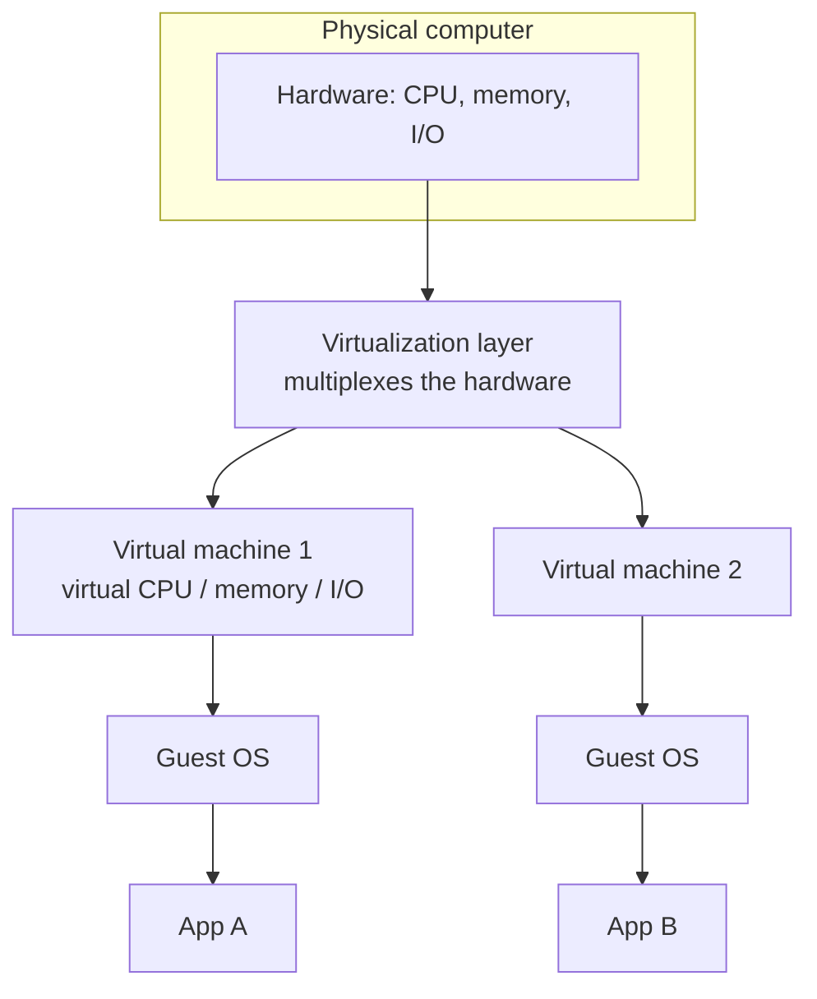
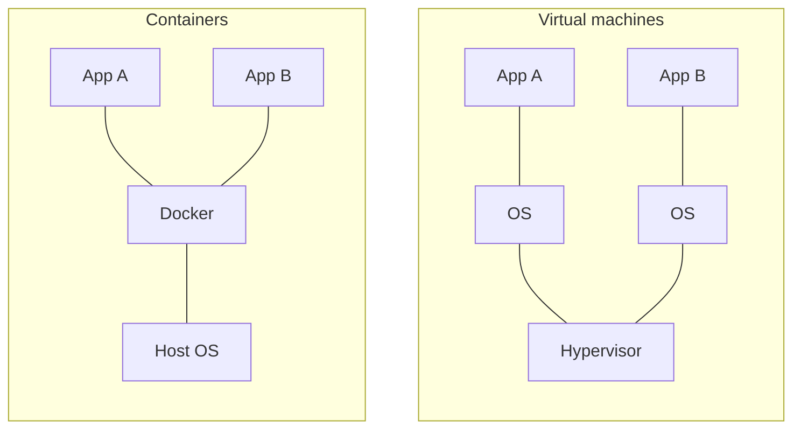

# Virtualization

> [!definition]
> **Virtualization** (*Virtualisierung*) is the **emulation of hardware objects by
> functionally equivalent objects of the same type with the help of a software layer.**

> [!definition]
> A **virtual machine** **emulates the computer architecture of a computer that really
> exists in hardware** — for example **hardware A on hardware B**.

## Server consolidation

> [!definition]
> **Server consolidation** (*Server-Konsolidierung*) is the **merging of virtual servers
> onto few physical servers.**

- leads to **better hardware utilization**
- advantages: **reduction of hardware costs**, **simplified administration**, **simplified
  provisioning of new servers**, **support of legacy applications**

## The problem being solved

| Layer | Situation on a physical computer |
|---|---|
| **Hardware** | CPU, memory, I/O modules — **resources are often not fully utilized** |
| **Software** | **tightly coupled to the hardware**; **one OS per piece of hardware** |

## Virtualization at hardware level

- **abstraction of the hardware**: **virtual CPU, memory, I/O modules**; it **encompasses
  the state of the OS and of the applications**
- **virtualization layer** (*Virtualisierungsschicht*): a **special software layer that
  decouples hardware and OS**
- **the physical hardware is multiplexed**
- **the virtualization layer manages the physical resources. These are presented to each OS
  as if they were actually present.**

## Advantages

- **reduction of the number of computers**
- **increase of computer utilization**
- **energy saving through optimal computer utilization**
- **independence from the hardware**
- **migration of servers during operation**
- **simplified software installation**
- **increase of availability**

## Disadvantage

> [!warning]
> With virtualization at hardware level, **every VM needs its own guest operating system.**
> **Consequence: a larger image, increased CPU and main-memory consumption.**

## The alternative: containers

> **Applications run in containers, which share one operating system.**

> [!inference]
> The container diagram is the VM diagram with **one box deleted** — the per-application
> guest OS. That single deletion is the entire argument: it removes exactly the cost the
> `[!warning]` above names, and it costs exactly the isolation that a separate OS was
> providing. See [[concepts/containers]].

> [!inference]
> "Independence from the hardware" and "migration during operation" are the same property
> stated statically and dynamically. Once the OS talks only to the virtualization layer, the
> physical machine underneath it has become **interchangeable at runtime** — and that is the
> precondition for both [[concepts/elasticity|elasticity]] and the "merging onto few
> physical servers" of consolidation.

> [!exam]
> Keep the two definitions apart: **virtualization** is the general technique (emulating a
> hardware object with a functionally equivalent one), a **virtual machine** is the specific
> product (an emulated computer architecture), and **server consolidation** is the business
> motive (many virtual servers onto few physical ones).

## Related
- [[concepts/containers]]
- [[concepts/cloud-computing]]
- [[concepts/cloud-service-models]]
- [[concepts/storage-architectures]]
- [[concepts/libraries-frameworks-and-containers]]
- [[concepts/elasticity]]
- [[chapters/05-distributed-resources-and-synchronization]]
