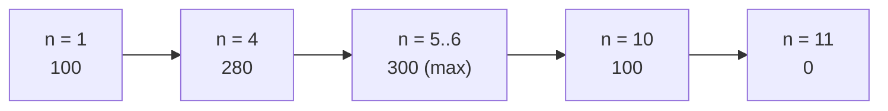
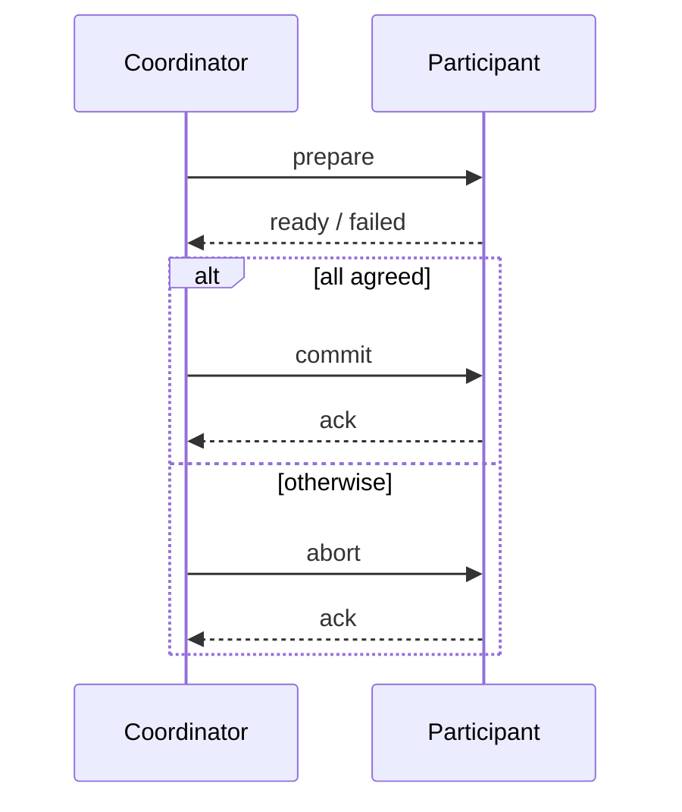

# Exercise 2 — Foundations, Scalability, Byte Order and 2PC

Exercise sheet accompanying [[chapters/02-foundations-of-distributed-systems]].

---

## Task 2.1 — Definitions

**1) What is a distributed system?**

A system is a distributed system if
- its **software components reside on networked computers**,
- the components **communicate only by exchanging messages**, and
- it is **present to the user as a single coherent system**.

**2) Multiprocessor system vs. distributed system**

| Distributed system | Multiprocessor system |
|---|---|
| **No shared memory** → remote syscalls | **Shared memory** → tight communication |
| Communication **via messages** — *a protocol is needed* | — |
| **Heterogeneous system** → *middleware is needed* | **Homogeneous system** |
| **No global clock** → synchronization required | **Global clock** |
| Synchronization of components can lead to **deadlocks** | — |
| **Concurrency hard to control** | — |

**3) Memory-based and message-based communication?**
See [[concepts/communication-paradigms]] — the definitions are reproduced verbatim there.

**4) Scalability and transparency?**
See [[concepts/transparency]] and [[concepts/scalability]].

**5) Synchronous / asynchronous communication?**
See [[concepts/synchronous-communication]] and [[concepts/asynchronous-communication]].

---

## Task 2.2 — Scalability of replicated file servers

**Setting.** A file server serves **100 file accesses per second** for clients. Further
servers receive **copies of the files**. For synchronization, a server needs **a connection
to every other file server**, and **per connection it delivers about 10 file accesses per
second fewer**.

### 1) How many servers are needed to deliver at least 250 accesses per second?

Each of the n servers maintains n − 1 synchronization connections, so each delivers
`100 − 10(n − 1)`:

| n | per server | total |
|---|---|---|
| 1 | 100 | **100** |
| 2 | 90 | **180** |
| 3 | 80 | **240** |
| 4 | 70 | **280** |

**4 servers** are required — 3 servers only reach 240 < 250.

### 2) Derive f(n), the maximum number of file accesses per second for n replicated servers

```text
f(n) = n · 100 − 10 · (n − 1) · n
     = 100n − 10(n² − n)
     = 100n − 10n² + 10n
     = 110n − 10n²
     = 10n(11 − n)
```

> [!exam]
> The trap is forgetting the outer factor n: the loss `10(n − 1)` applies **per server**, so
> it must be multiplied by n. An answer of `90n + 10` comes from subtracting the loss only
> once and is wrong — the summary shows this first attempt struck out.

### 3) From which point are additional servers useless?

`f(n) = 10n(11 − n)` is a downward parabola with roots at n = 0 and **n = 11**.

- **From 11 servers onwards the system is useless** — `f(11) = 0`.
- The **maximum is at n = 5 and n = 6**, both giving `f = 300`; from 6 servers onwards
  throughput falls.


*Throughput rises, peaks, then collapses — the canonical sub-linear
[[concepts/speedup|speed-up]] curve.*

> [!inference]
> `f(5) = f(6) = 300` because the vertex of the parabola lies at n = 5.5. The summary notes
> "falling from 6 servers", which is consistent; 5 is the cheapest optimum.

**Technique.** Model the *per-node* benefit and the *per-node* coordination cost separately,
multiply each by the node count, and subtract. Coordination that grows with n − 1 per node
always produces an n² term, hence an eventual collapse.

---

## Task 2.3 — Byte order and `htonl()`

**Big-endian:** the end comes first. **Little-endian:** the beginning comes first.

### 1) Which numbers result from reading the words as big-/little-endian?

| Word | Bytes (hex) | Bytes (decimal) |
|---|---|---|
| w₁ | `0x00 0x24 0x1E 0x14` | 0, 36, 30, 20 |
| w₂ | `0x01 0x02 0x03 0x04` | 1, 2, 3, 4 |
| w₃ | `0x05 0x06 0x06 0x05` | 5, 6, 6, 5 |

Conversion of a single byte, e.g. `0x24 = 2·16 + 4 = 36`, `0x1E = 1·16 + 14 = 30`,
`0x14 = 1·16 + 4 = 20`.

With interpretation **A** weighting the first byte most significantly and **B** weighting it
least significantly:

```text
w1:  A = 0·2²⁴ + 36·2¹⁶ + 30·2⁸ + 20·2⁰ = 2 366 996
     B = 0·2⁰  + 36·2⁸  + 30·2¹⁶ + 20·2²⁴ = 337 519 616

w2:  A = 1·2²⁴ + 2·2¹⁶ + 3·2⁸ + 4·2⁰
     B = 1·2⁰  + 2·2⁸  + 3·2¹⁶ + 4·2²⁴

w3:  A = B = 5·2²⁴ + 6·2¹⁶ + 6·2⁸ + 5·2⁰
```

**Method.** *First convert byte-wise to decimal*, then weight:
`A = a₁·2⁰ + a₂·2⁸ + …`, `B = a₁·2²⁴ + a₂·2¹⁶ + …`

> [!inference]
> w₃ is a **palindrome**, so both interpretations coincide. That is the point of the third
> example.

### 2) What does `htonl()` do?

`htonl()` **converts the unsigned integer `hostlong` from host byte order to network byte
order.** See [[concepts/byte-order]].

---

## Task 2.4 — Two-phase commit protocol

**Transaction.** A group of logically connected data operations, executed **either completely
or not at all**. All actions are undone if an error occurs; no error ⇒ commit.

**2PC.** A distributed transaction is carried out by the **coordinator**.
- **Phase 1:** agreement/rejection of the transaction by all participating machines —
  all agree ⇒ **commit**, otherwise ⇒ **abort**.
- **Phase 2:** transmission of the result to all participants; each performs a local commit
  or abort and afterwards informs the coordinator.

**1) Example of a real distributed transaction.**
A **bank transfer** carried out against the database system of the sender's bank and the
database system of the recipient. If the money transfer to the second bank fails, the money
must be **written back** to the sender.

**2) How can the old state be restored?**
The **participants look into the log** and thereby **reset the variables**.

**3) Sequence diagram.**



**4a) When is this correct if no errors occur?**
**All agreed ⇒ coordinator commits ⇔ every participant performs a local commit.**

**4b) How many messages for n participants?**
`2n + 2n = ` **4n messages**.

**5) Failure cases.**

| Case | Consequence |
|---|---|
| a) **Coordinator crashes** before receiving all replies | the **participants block** and stay blocked |
| b) **Participant crashes** — the coordinator receives no reply to `prepare` | the **coordinator blocks** |
| c) **Lost message** | blocks the **coordinator and/or the participant** |

Full treatment, pseudocode and state machine in [[algorithms/two-phase-commit]].

---

## Practical 2 — C++ sockets

Header selection and the Winsock startup sequence are recorded in
[[concepts/sockets]] (section "Sockets in C/C++").

---

## Related
- [[chapters/02-foundations-of-distributed-systems]]
- [[concepts/scalability]]
- [[concepts/speedup]]
- [[concepts/byte-order]]
- [[algorithms/two-phase-commit]]
- [[concepts/distributed-system]]
