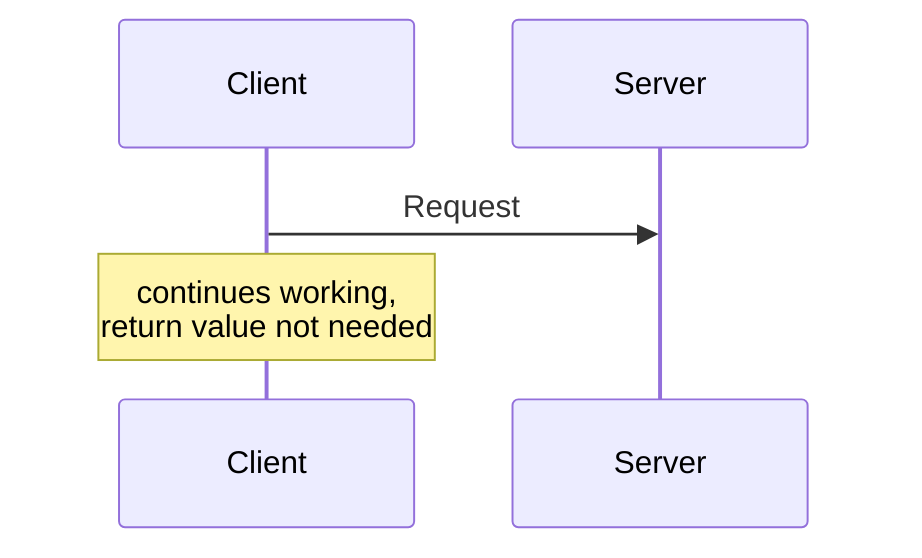
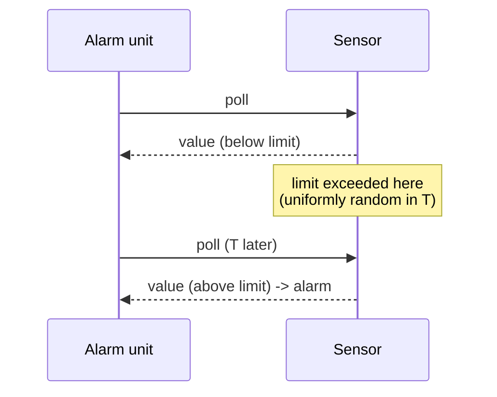

# Exercise 3 — Architectures, Push/Pull, HTTP and Replication

Covers exercise sheet 3 (tasks 3.1–3.7) and practical 3.

## 3.1 Short questions

**1) Pull and push communication?**
See [[concepts/pull-and-push-style]]. Pull: the consumer controls the flow and explicitly
requests data; it is not informed of new data. Push: the producer controls the flow and
informs or sends unasked; the consumer must register.

**2) Cloud computing?**
See [[concepts/cloud-computing]].

**3) One-way communication?**
The client sends a request and **continues working**; **no return value is needed.**



**4) Framework vs. library?**
> A developer calls the functions of the library within their own code. In contrast, the
> **framework calls the provided functions itself.**

See [[concepts/libraries-frameworks-and-containers]].

**5) Why is HTTP called a text-based protocol?**
**Because the header is ASCII-coded.**

**6) What is a cookie, and what use do cookies have?**
A cookie is an **HTTP header**. It stores e.g. the **session ID**, or is used generally for
transferring data; it **stores the user state**. See [[concepts/sessions-and-statelessness]].

**7) Name four procedures to increase the scalability of HTTP.**
Persistent connections; pipelining; data compression (header compression); combining several
requests (multiplexing); binary-coded transfer; out-of-order delivery. See
[[concepts/http-scalability]].

**8) Separation of Concerns?**
> A design principle for separating a program into distinct sections such that each section
> addresses a separate concern.

## 3.2 Push vs. pull for a sensor

**Setup:** a measurement is taken **every second**. Four consumers:

1. A **display board** should always show the current value.
2. An **external database** wants to log the current value **every second**.
3. The current value should be shown **in an app on demand**.
4. An **external unit** should trigger an **alarm when a limit value is exceeded**.

### a) Network load — messages per time unit

Pull costs **two** messages per poll (request + response); push costs **one** per update.

| Case | Pull | Push | Advantageous |
|---|---|---|---|
| 1) Display board | 7200 msg/h | 3600 msg/h | **push** |
| 2) Database, every second | 2 msg/s | 1 msg/s | **push** |
| 3) App, on demand | 2·*n* msg/h | 3600 msg/h | **pull** |
| 4) Alarm unit | 7200 msg/h | 3600 msg/h | **push** |

```text
pull_load = 2 · poll_rate           # request + response
push_load = 1 · update_rate         # one notification

# with update_rate = 1/s = 3600/h:
#   cases 1,2,4 need the value as often as it changes -> poll_rate = update_rate
#                                 => pull = 2·3600 = 7200 > 3600 = push
#   case 3 needs it only n times per hour, n << 1800
#                                 => pull = 2n < 3600 = push
```

> [!exam]
> The decisive quantity is **how often the value is actually needed versus how often it
> changes.** Only case 3 (on demand, rarely) breaks the tie in favour of pull, and it does so
> exactly when 2·*n* < 3600, i.e. **n < 1800 requests per hour**.

### b) Polling interval for the alarm unit

**Question:** with pull communication, how large may the polling interval be so that the
alarm is triggered **on average 1 s later** than the limit violation?

The limit violation occurs at a uniformly random point inside a polling interval of length
*T*.

```text
best case  : the violation happens just before a poll   -> delay ≈ 0
worst case : the violation happens just after a poll    -> delay ≈ T

average = (best + worst) / 2 = (0 + T) / 2 = 1 s
      => T = 2 s
```

> [!theorem]
> **Polling interval = 2 s.** In general, an average detection delay of *d* requires a
> polling interval of **T = 2*d***.



> [!inference]
> This is a clean demonstration of why push wins for alarms on *latency* as well as on
> message count: push detects in ~0 s, while pull trades message load against detection
> delay linearly.

## 3.3 Implementing push communication

**Whereas the address of the server is generally known to the client**, so that pull
communication can easily be carried out, **the reverse does not hold.**

**Q: What options are there in principle to carry out push communication anyway?**
> **Clients must register with the server.**

**Q: What influence does a firewall or a NAT have on feasibility?**
> **It can block the push messages.**

**Q: Problems when the number of clients is very large?**
> **Many messages**, and it is **hard to store all clients.**

See [[concepts/pull-and-push-style]].

## 3.4 HTTP

**1) Which character string is produced when coding the parameters?**

```text
name=Bartholomaeus_Mueller&e-mail=Rati@mueller&geschlecht=m&newsletter=yes
```

**2) In which part of the HTTP message are the data sent to the server?**
> **In the HTTP body.**

```http
POST /register.php HTTP/1.1
Host: www.server.org
Content-Type: application/x-www-form-urlencoded
Content-Length: 83

name=Myname&email=mymail
```

See [[concepts/http]].

## 3.5 JSON

```java
JSONObject book = new JSONObject();
book.put("Title",   "Bla");
book.put("Auflage", 3000);
book.put("Preis",   39.80);
book.put("Inhalt",  null);

JSONObject author = new JSONObject();
author.put("Vor",  "Volker");
author.put("Nach", "Turau");
book.put("Autor", author);
```

`book.toString()`:

```json
{
  "Title": "Bla",
  "Auflage": 3000,
  "Preis": 39.80,
  "Inhalt": null,
  "bestseller": true,
  "Autor": { "Vor": "Volker", "Nach": "Turau" }
}
```

See [[concepts/json]].

## 3.6 Sessions

Session IDs exist **to recognize that different requests come from the same user.** Normally,
on a user's first request, a **random number from a very large value range** is generated,
assigned to them by the server, and sent along by the client with every request.

**A developer wants to avoid generating a random number for each new session. To save time
they lay out a pool of random numbers at system start. Disadvantages?**

- **Limited number of session IDs.**
- **Brute force can simply find all SIDs.**
- **The privacy of the users is no longer safe.**
- **SIDs are easy to guess.**
- **Even data of "old users" can be seen** (IDs are recycled).
- **DoS attacks** — the pool can be exhausted.

See [[concepts/sessions-and-statelessness]].

## 3.7 Replication

**Setup:** a non-replicated document of size *s* bytes is requested *r* times per second by
independent computers. The document is replicated to *k* different servers and updated *w*
times per second. Updates are forwarded to each replica individually. There is a server with
a replica near every requester, so in that case **no further cost arises for the request.**

**From when are the costs (bandwidth, B/s) for the procedure with replication lower than for
the non-replicated procedure?**

```text
cost_without_replication = s · r
cost_with_replication    = s · k · w

s · r  >  s · k · w
     r  >  k · w
```

> [!theorem]
> Replication is cheaper exactly when **r > k·w** — the request rate exceeds the total update
> traffic. **The document size *s* cancels and is irrelevant.**

See [[concepts/replication]].

## Practical 3

**1) `URL` — the Java class for HTTP requests**

```java
int getResponseCode() {
    URL url = new URL("http://example.com/index.html");
    URLConnection urlCon = url.openConnection();
    int statusCode = ((HttpURLConnection) urlCon).getResponseCode();
    return statusCode;
}
```

**2) JSON with Gson**

```java
import com.google.gson.Gson;

Gson gson = new Gson();
String jsonString = gson.toJson(myObject);
MyClass mc = gson.fromJson(jsonString, MyClass.class);
```

**3) HTTP methods**

**GET** is used to **request data from a specific resource**:
```http
GET /index.php?suche=test HTTP/1.1
```

**POST** is used to **send data to a server to create or update a resource**:
```http
POST /test/demoform.php HTTP/1.1
Host: www.google.de

name1=Mike&name2=Trzaska
```

## Related
- [[chapters/03-architectures-and-web-systems]]
- [[concepts/pull-and-push-style]]
- [[concepts/http]]
- [[concepts/http-scalability]]
- [[concepts/sessions-and-statelessness]]
- [[concepts/json]]
- [[concepts/replication]]
- [[concepts/libraries-frameworks-and-containers]]
- [[concepts/performance-criteria]]
- [[exercises/ex02-foundations-and-2pc]]
