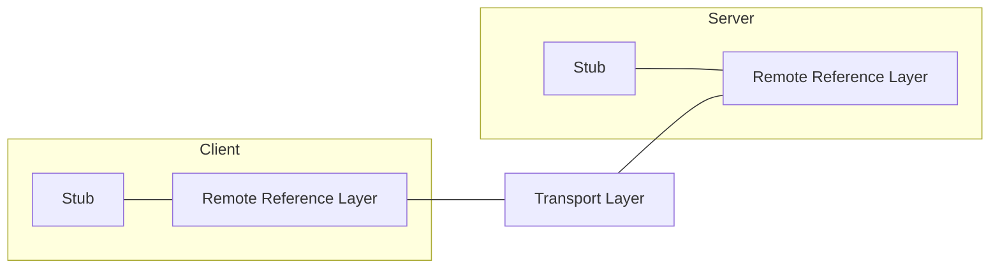
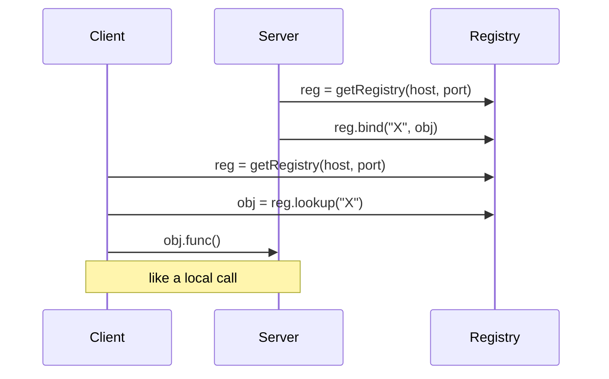

# Exercise 4 — RPC, RMI, BER and Call Semantics

Covers exercise sheet 4 (tasks 4.1–4.4, 4.6, 4.7).

> [!warning]
> Task **4.5 is absent** from the summary — the numbering jumps from 4.4 to 4.6.

## 4.1 Definitions

**a) Remote invocation?**
> Remote invocation is a technique for realizing inter-process communication. It enables the
> calling of functions in other address spaces.

**RPC:** call of procedural functions in other address spaces — client programs call
functions in server programs.
**RMI:** call of object-oriented methods in other address spaces — objects call methods of
other objects in another process or computer.
See [[concepts/remote-invocation]].

**b) External data representation? Marshalling/unmarshalling?**
> External data representation: a data format which is used in the transmission of data in a
> communication network.
> The conversion of data in the local data format into the external data format is called
> marshalling, the reverse process unmarshalling.

See [[concepts/external-data-representation]].

**c) What are stubs?**
> Stubs are local procedures which are generated from the actual procedure by a tool.

| Client stub | Server stub (skeleton) |
|---|---|
| is a proxy | waits for requests |
| controls the transmission protocol | unpacks the parameters |
| marshals and packs the parameters into a message | calls the local procedure |
| sends the message, waits for the answer, unpacks it | packs the return value into a message and sends it |

See [[concepts/stubs-and-skeletons]].

**d) Failures with remote calls?**
Client does not find the server; client crashes after sending the call; call message is
lost; server crashes after receiving the call (before sending the answer / before executing
the call); answer is lost; client crashes before receiving the answer.
See [[concepts/remote-call-failures]].

**e) Which call semantics?**
At-most-once, at-least-once, **exactly-once ✓** (the one you want — and cannot have; see
task 4.6 and [[concepts/call-semantics]]).

**f) IDL?**
> An IDL is a declarative formal language and contains a language syntax for describing the
> interfaces of a software component.
> → it generates the stubs.

See [[concepts/interface-definition-language]].

## 4.2 RPC vs. RMI

RPC lives **in the client stub and the server stub**, over **TCP/IP**, with **synchronous
calls**.

**What must the client send to the server at minimum with a remote function call?**
> The **function name** and the **parameters**.

**What happens when the remote function call is received in the stub on the server side?**
> The stub unpacks the message, calls the local function, packs the return value into a
> message and sends it.

**Why does it make no sense to pass a pointer?**
> Different address spaces.

**Which information is sent back from the server exclusively?**
> The return value.
>
> Yes/no: with `void` functions a response still makes sense, so that the client knows the
> call was carried out successfully. → and for exceptions.

**How does the difference between RPC and RMI show in the information the client sends?**
> **On which object the method is called**, and **objects can be parameters.**

**How is the passing of objects as references realized with remote method calls?**
> If the type of a parameter is a remote interface, then it is passed as a **remote object
> reference** → ask the registry.



**Remote Reference Layer:** translation of remote/local object references on the basis of a
remote object table; creation of remote references. See [[models/java-rmi]].

**Let `A` be a Java class which implements `Serializable` but not `Remote`. A method in a
remote interface has return type `A`. Which object does a client get back?**
> If it is returned this way, **a new object is created in the client's process. This object
> is independent of the original object.**

See [[concepts/distributed-object-model]].

## 4.3 Semantics of RPC — a protocol with at-most-once semantics

> - Store for each client the **last call**.
> - Compare each new call with the last call of that client.
> - If it is the same, then **do not execute the call**.

```text
state:
    last[c] ← ⊥                       # per client: the most recent ⟨seq, result⟩

on receive ⟨CALL, c, s, f, args⟩:
    if last[c] ≠ ⊥ and last[c].seq = s:
        reply with last[c].result     # duplicate -> replay, do NOT execute
    else:
        r ← execute f(args)
        last[c] ← ⟨s, r⟩
        reply with r
```

Written out in full in [[algorithms/at-most-once-rpc]].

## 4.4 Basic Encoding Rules (BER)

Encoding rules and the type/length layout are on [[concepts/basic-encoding-rules]].

### Decode

| Bytes | Decoding |
|---|---|
| **a)** `02h 01h E6h` | Integer, 1 byte, `1110 0110` = −2⁷+2⁶+2⁵+2²+2¹ = **−26** |
| **b)** `01h 01h FFh` | Boolean, 1 byte, **true** |
| **c)** `02h 01h 00h` | Integer, 1 byte, **0** |

**d)** `30h 82h 00h 0Ch 02h 01h 0Fh 04h 04h A0h 0Fh 02h 01h 01h 01h 00h`

```text
30h            -> 00 1 10000  = universal, complex, Sequence
82h 00h 0Ch    -> long form: the next 2 bytes give the length = 12
  02h 01h 0Fh                 -> Integer 15
  04h 04h A0h 0Fh 02h 01h     -> Octet string, 4 bytes: A0 0F 02 01
  01h 01h 00h                 -> Boolean false
check: 3 + 6 + 3 = 12 ✓
```

### Encode

| Value | Encoding |
|---|---|
| **e)** Integer 20 | `02h 01h 14h` |
| **f)** Integer −80 | `02h 01h B0h` |
| **g)** `true` | `01h 01h FFh` |
| **h)** `'0x01 0x23 0x45'` | `04h 03h 01h 23h 45h` |
| **i)** `Sequence(32 int, true, '0x61 0x0A')` | `30h 0Ah 02h 01h 20h 01h 01h FFh 04h 02h 61h 0Ah` |

For (i): the three elements occupy 3 + 3 + 4 = **10 = 0x0A** bytes, which is the sequence's
length byte (short form, since 10 < 128).

> [!warning]
> The handwritten values for (i) are hard to read in the scan; the structure (three TLVs of
> 3, 3 and 4 bytes inside a `30h` sequence) is unambiguous and matches the encoding above.

## 4.6 Client/server semantics — a print job

**Setup.** The client sends a print job. The server sends a confirmation (*received*). After
a crash, the server sends "*back again*" to all clients. The server also sends a **"done"
message**; a job that has been started should be completed.

"Done" is sent either
1. **before** the print job is started, or
2. **after** the print job has been started.

After a server crash, the client's retry strategy may be:
a) **always**, b) **never**, c) **only if "done" was received**, d) **only if "done" was not
received**.

Write **P** = print job started, **F** = "done" message, **C** = crash. The entry is the
number of executions: **0** = not carried out, **1** = exactly once, **2** = twice.

| Retry strategy | PFC | PC(F) | C(PF) | C(FP) | FC(P) | FPC |
|---|---|---|---|---|---|---|
| **a) always** | 2 | 2 | 1 | 1 | 1 | 2 |
| **b) never** | 1 | 1 | 0 | 0 | 0 | 1 |
| **c) only if "done" received** | 2 | 1 | 0 | 0 | 1 | 2 |
| **d) only if "done" not received** | 1 | 2 | 1 | 1 | 0 | 1 |

The first three columns are the **P-before-F** ordering, the last three the **F-before-P**
ordering; parentheses mark events that never happened because the crash preceded them.

### How to read a single cell

```text
# column PC(F), strategy d) "retry only if done was NOT received"
P  -> the job ran once
C  -> the server crashed before sending "done"
F  -> never arrives, so the client retries
=> the job runs a second time  -> 2
```

> [!theorem]
> **No row consists entirely of 1s.** Strategies (a) and (b) fail by construction; (c) is
> correct for F-before-P but doubles for P-before-F; (d) is the mirror image.
> **Exactly-once semantics is therefore unachievable** — the client cannot know the ordering
> of the side effect and the acknowledgement.

See [[concepts/call-semantics]].

## 4.7 RMI registry

> Java RMI uses a registry for the registration of objects.



> **Not all objects need to be registered — a method can also return a reference to an
> object.**

See [[concepts/rmi-registry]].

## Related
- [[chapters/04-remote-invocation]]
- [[concepts/remote-invocation]]
- [[concepts/stubs-and-skeletons]]
- [[concepts/basic-encoding-rules]]
- [[concepts/call-semantics]]
- [[concepts/distributed-object-model]]
- [[concepts/rmi-registry]]
- [[algorithms/at-most-once-rpc]]
- [[models/java-rmi]]
- [[exercises/ex03-architectures-and-http]]
