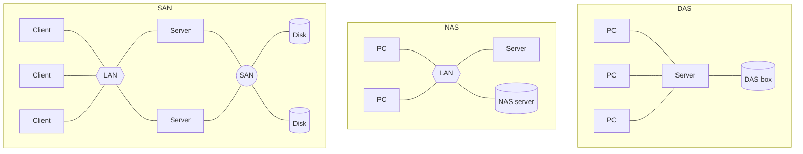

# Exercise 5 — Storage Architectures and Clock Synchronization

## 5.1 a) Storage architectures

The task asks for **DAS**, **NAS** and **SAN**. The full write-up lives on
[[concepts/storage-architectures]]; the exercise reproduces the bullet lists together with
these topology sketches:



> [!warning]
> The summary jumps from task **5.1 a)** straight to **5.1 c)**. Task **5.1 b) is absent**
> from the source.

## 5.1 c) Criticism of averaging clock times

> **Some time algorithms form the arithmetic mean of the clock times of the individual
> computers and take this value as the new clock time. Criticism?**

> [!definition]
> Answer from the summary: **the value can be changed for the worse.**

> [!inference]
> Spelled out: the arithmetic mean has **no relation to the correct time**. It is pulled by
> every wrong clock in the group, so a computer that happened to be *right* is dragged away
> from the truth, and a group that is uniformly wrong stays uniformly wrong. The mean also
> has no robustness — a single wildly broken clock shifts it by `1/n` of its error, which is
> why [[algorithms/berkeley-algorithm|Berkeley]] adds outlier rejection. Task **5.3 (2)
> constructs exactly this situation.**

> [!exam]
> Link the answer to [[concepts/clock-synchronization]]: averaging is **internal**
> synchronization, and internal synchronization makes **no claim at all** about real time.
> The criticism is not that the mean is a bad estimator — it is that it is not an estimator
> of anything external.

## 5.1 d) Drift computation

> **Two computers in a distributed system both have clocks that should tick 1000 times per
> millisecond. One of them does, but the other ticks only 999 times per millisecond. How
> large is the drift, if a UTC refresh arrives once per minute?**

| Step | Correct clock | Slow clock |
|---|---|---|
| Ticks per ms | 1000 | 999 |
| Ms per minute | 60 000 | 60 000 |
| **Ticks per minute** | **60 000 000** | **59 940 000** |

```text
difference = 60 000 000 − 59 940 000 = 60 000 ticks
           = 60 000 ticks ÷ 1000 ticks/ms
           = 60 ms per minute
```

**Answer: the drift is 60 ms per minute.**

As a drift rate in the sense of [[concepts/clock-correctness]]:

```text
ρ = 60 000 / 60 000 000 = 10⁻³
```

> [!warning]
> The source's intermediate line is **inconsistent with its own final answer**. It writes
> `56 940 000` ticks per minute and a difference of `3 060 000`, but then concludes
> `60 ms/min`. Only the final answer is correct: `999 × 60 000 = 59 940 000`, giving a
> difference of `60 000` ticks `= 60 ms`. The arithmetic above has been re-derived and the
> intermediate figures corrected.

## 5.2 Cristian vs. Berkeley

| | **Cristian** | **Berkeley** |
|---|---|---|
| **Goal** | **external** | **internal** |
| **Procedure** | latency `(t₃ − t₀ − Θ) / 2` | `D_i = Σ A_j / n − A_i` |
| **Weakness** | **asymmetric latency** | **central server**, and the result is only **internal** |

> [!inference]
> The two weaknesses are of different kinds and it is worth being explicit about it.
> Cristian's is a **measurement** weakness — the estimate `δ/2` is wrong by the asymmetry,
> and the protocol cannot detect it. Berkeley's is a **definitional** weakness — its answer
> is not wrong, it simply is not an answer to the question "what time is it?". No amount of
> better measurement fixes Berkeley.

> [!exam]
> Both share the *central component* criticism named on p. 22: bottleneck and poor
> fault-tolerance. Berkeley partly escapes it because **any computer can take over the time
> server role**; Cristian cannot, because its server is the one holding UTC.

## 5.3 Berkeley algorithm, worked

> **The clocks in a distributed system with 5 computers (`R_i`, `i ∈ {0, …, 4}`) are
> synchronized by applying the Berkeley algorithm. At time `T` the computer clocks `C_i`
> stand at:**

| Computer | `C_i(T)` |
|---|---|
| `R_0` (**master**) | 1:01:07 |
| `R_1` | 1:01:03 |
| `R_2` | 1:01:09 |
| `R_3` | 1:01:04 |
| `R_4` | 1:01:07 |

> **The master is `R_0`; `RTT = 2 s`, so one way is `RTT/2 = 1 s`.**

> [!warning]
> The scan of `C_2(T)` is ambiguous — the final digit reads as either `4` or `9`. It has
> been **reconstructed as 1:01:09**, because the source's own answer `A_2 = +2` requires it
> (see the derivation below). `C_3(T) = 1:01:04` is unambiguous.

### (1) The deviations `A_i` and corrections `D_i`

The master's `TIME` message, sent at `T`, arrives at slave `R_i` at `T + RTT/2`. The slave
reads its own clock on arrival and reports

```text
A_i' = C_i(T + RTT/2) − C_0(T) = C_i(T) + 1 − C_0(T)
```

The master then discounts the one-way transit:

```text
A_i  = A_i' − RTT/2 = C_i(T) − C_0(T)
```

> [!inference]
> The two corrections cancel exactly, so `A_i` reduces to the **plain difference of the two
> clock readings at `T`**. The `RTT/2` arithmetic in the source is not wasted work — it is
> what *justifies* treating the reported value as a reading taken at `T`.

| `i` | `C_i(T)` | `A_i' = C_i + 1 − C_0` | `A_i = A_i' − 1` | `D_i = D − A_i` | Corrected clock |
|---|---|---|---|---|---|
| 0 | 1:01:07 | — | **0** | **−1** | 1:01:06 |
| 1 | 1:01:03 | −3 | **−4** | **+3** | 1:01:06 |
| 2 | 1:01:09 | +3 | **+2** | **−3** | 1:01:06 |
| 3 | 1:01:04 | −2 | **−3** | **+2** | 1:01:06 |
| 4 | 1:01:07 | +1 | **0** | **−1** | 1:01:06 |

```text
Σ A_j = 0 + (−4) + 2 + (−3) + 0 = −5
D     = Σ A_j / (n + 1) = −5 / 5 = −1
```

**All five clocks end at 1:01:06.** This matches the source's answers
(`D_1 = +3`, `D_2 = −3`, `D_3 = +2`, `D_4 = −1`, `D = D_0 = −1`) exactly.

> [!inference]
> The check that the exercise is self-consistent is that **every corrected clock reads the
> same value** — which it must, since `C_i + D_i = C_i + D − (C_i − C_0) = C_0 + D` for
> every `i`. If your table does not collapse to one value, an `A_i` is wrong.

### (2) What if `R_2` had the correct time?

> **Suppose `R_2` had the correct clock time at instant `T` (`C_2(T) = T`). What did the
> synchronization achieve?**

If `C_2(T) = T`, the true time at `T` is **1:01:09**. After synchronization every computer —
including `R_2` — reads **1:01:06**.

> [!definition]
> **The synchronization moved the one correct clock in the system 3 seconds away from the
> true time, and put the whole group 3 seconds behind it.** The system is now perfectly
> synchronized **internally** and uniformly **wrong externally**.

> [!warning]
> The source's working for this part (`D_1 = 3 − 2 = 1`, `D_2 = 3 − 6 = …`) is **incomplete
> and inconsistent** with part (1) — it is cut off mid-line. The derivation above was
> reconstructed from the part-(1) results.

> [!inference]
> This is the counterexample promised by [[concepts/clock-synchronization]]: the `2D`
> theorem runs from external to internal and **has no converse**. It is also the concrete
> answer to task 5.1 c) — "the value can be changed for the worse" is not a theoretical
> worry, it happens here to the only clock that was right. Berkeley's outlier rejection
> would not have saved it either: with four clocks clustered around 1:01:03–1:01:07, the
> *correct* clock at 1:01:09 is the outlier.

> [!exam]
> The expected one-liner: **internal synchronization succeeded, external accuracy was
> destroyed.** Then name the reason — the group average is not anchored to any external
> reference.

## Related
- [[concepts/storage-architectures]]
- [[concepts/clock-correctness]]
- [[concepts/clock-synchronization]]
- [[algorithms/cristians-algorithm]]
- [[algorithms/berkeley-algorithm]]
- [[chapters/05-distributed-resources-and-synchronization]]
