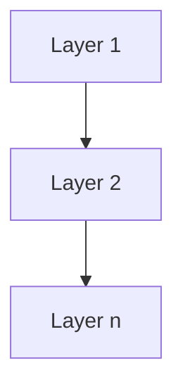
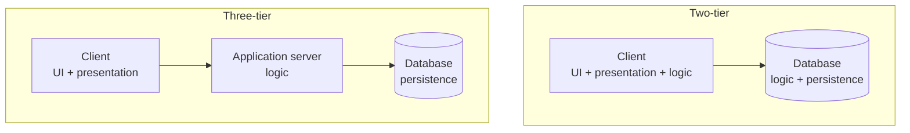
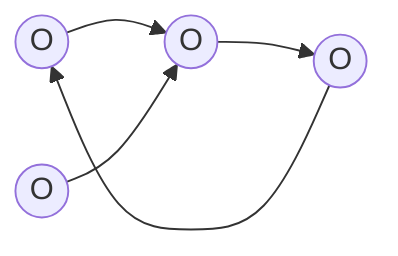
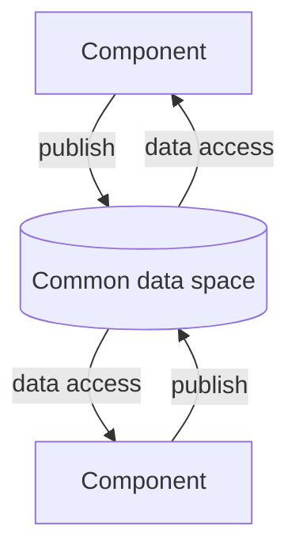
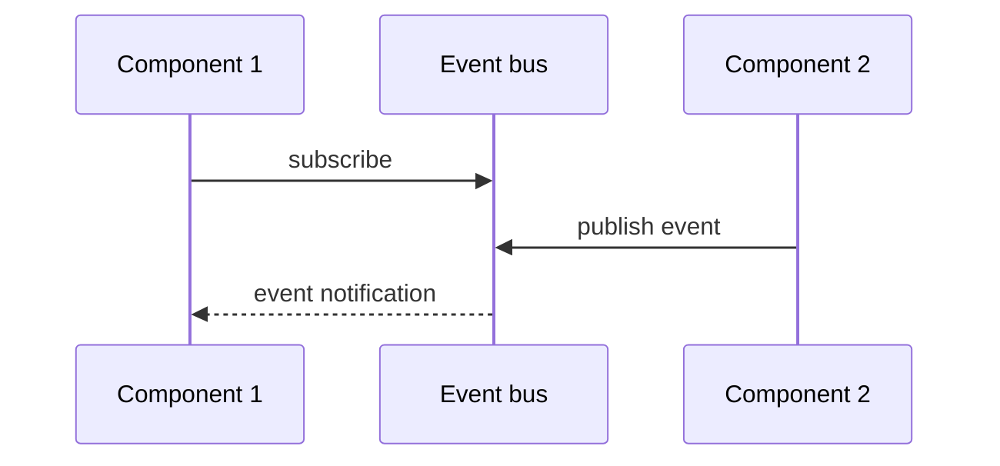

# Architectural Styles

Four ways of organizing components, ordered here from tightest to loosest coupling.

## 1. Layered architectures

- Individual aspects of the system are **conceptually assigned to a layer** — that is,
  **layer = component**.
- **Dependency relationships are only allowed from one layer to a layer beneath it.**
- Communication by **function calls or messages**.
- **Frequent copying of data between layers has a negative effect on scalability.**
- **Easy replacement of the implementation of a layer.**

*Strictly downward dependencies.*

### Two-tier architecture

| Tier | Responsibilities |
|---|---|
| **Client** | user interface; presentation of the data; **application logic** |
| **Server (database)** | application logic; consistency of the data; persistent management of the data |

### Three-tier architecture

| Tier | Responsibilities |
|---|---|
| **Client** | user interface; presentation of the data |
| **Application server** | application logic |
| **Database** | consistency of the data; persistent management of the data |

*Moving the application logic off the client is what distinguishes the two.*

> [!inference]
> The two-tier/three-tier split is the same decision as
> [[concepts/fat-and-thin-clients]]: a two-tier architecture implies a fat client.

## 2. Object-based architectures

- **Loose arrangement of objects** (= components).
- **Communication via method calls.**
- If objects reside **on different machines, the calls are remote calls**.

*No prescribed topology — objects call whichever objects they hold references to.*

## 3. Data-centric architectures

- **Components communicate through a common data space.**
- **No coupling**, [[concepts/pull-and-push-style|pull style]].

*Components never address each other directly, only the shared space.*

## 4. Event-based architectures

- Components **register explicitly with other components** and are **informed about their
  events**.
- **No polling, loose coupling, [[concepts/pull-and-push-style|push style]].**
- Realized as **publish–subscribe systems**.

*The bus decouples publisher from subscriber — neither needs the other's address.*

## Comparison

| Style | Coupling | Flow control | Communication |
|---|---|---|---|
| Layered | tight, strictly downward | caller | function calls / messages |
| Object-based | tight | caller | (remote) method calls |
| Data-centric | none | consumer (**pull**) | shared data space |
| Event-based | loose | producer (**push**) | event notifications |

> [!exam]
> Note the recurring pairing: data-centric ⇒ pull, event-based ⇒ push. Being able to name
> which style implies which information-flow direction is the point of the table.

## Related
- [[concepts/software-architecture]]
- [[concepts/pull-and-push-style]]
- [[concepts/service-oriented-architecture]]
- [[models/centralized-and-decentralized-architectures]]
- [[models/client-server-architecture]]
- [[chapters/03-architectures-and-web-systems]]
