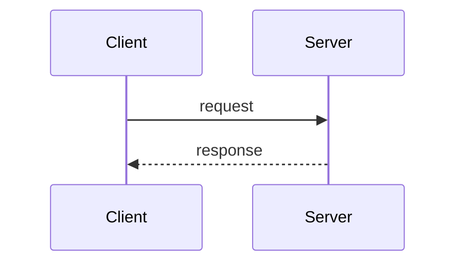
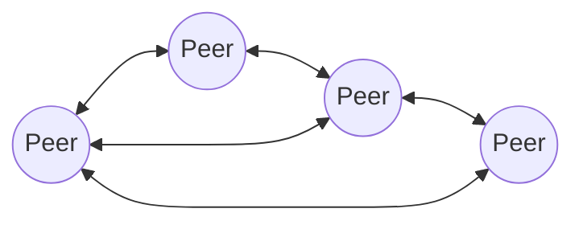

# Centralized and Decentralized Architectures

Where the roles sit: are components distinguished into servers and clients, or are they all
the same?

## Centralized architectures

- The **client–server model**.
- A **request/response model**.
- Examples: the **World Wide Web**, **e-mail**.

*The defining asymmetry: one side asks, the other answers.*

See [[concepts/server-and-client]] for the role definitions and
[[models/client-server-architecture]] for the implementation.

## Decentralized architectures

- **All components are the same** — each is **server and client** at once.
- **All components provide common services.**
- **Better efficiency and fault tolerance.**
- Realized as **peer-to-peer systems**.

*Every peer is simultaneously client and server.*

> [!exam]
> The open question the summary leaves hanging is the right one to remember:
> **"How do the peers find each other?"** Without a server there is no obvious rendezvous
> point — this is the central problem of peer-to-peer design.

> [!inference]
> Better fault tolerance follows directly from there being **no single point of failure** —
> the weakness that [[concepts/distribution-server]] reintroduces in the centralized world.

## Comparison

| | Centralized | Decentralized |
|---|---|---|
| Roles | distinct client and server | all components identical |
| Failure of one node | server failure is fatal | other peers continue |
| Finding partners | server address is known | **open problem** |
| Efficiency | bounded by the server | better |

## Related
- [[models/architectural-styles]]
- [[concepts/server-and-client]]
- [[models/client-server-architecture]]
- [[concepts/distribution-server]]
- [[chapters/03-architectures-and-web-systems]]
