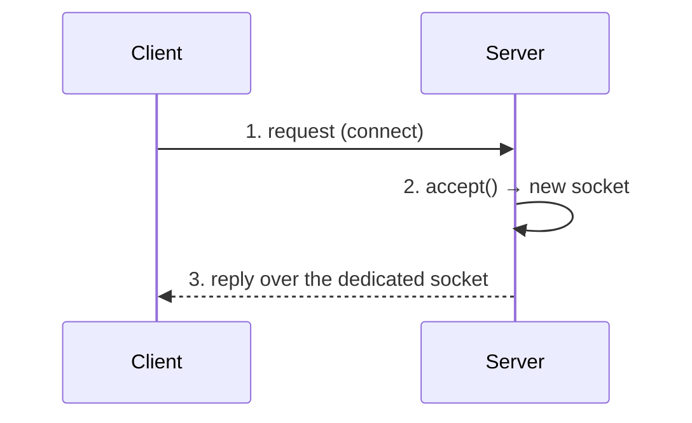
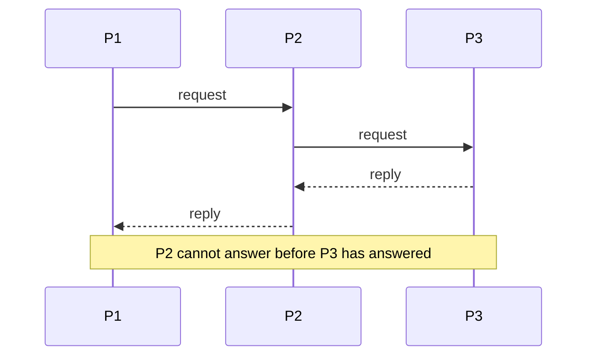

# Client–Server and Layered Architectures

The structural model behind every example in Chapters 1 and 2: one process offers a service,
others consume it, and the arrangement may be stacked into several tiers.

## The basic client–server interaction


*Matches the socket flow in [[concepts/sockets]]. Note that with
[[concepts/tcp]] the client/server distinction vanishes once the connection stands.*

## Server threading models

A server may be implemented **single-threaded** or **multi-threaded**.

```text
# multi-threaded server
state: active_threads ← 0, MAX ← limit

loop:
    conn ← accept()
    when active_threads < MAX:          # bound the pool!
        spawn worker(conn)
        active_threads ← active_threads + 1
```

**Assumptions:** requests are independent of each other.
**Message complexity:** unchanged by the threading model.
**Time complexity:** multi-threaded serves k requests concurrently; single-threaded
serializes them.
**Failure behavior:** without the `MAX` bound, a burst of clients exhausts server resources.

> [!definition]
> **Is it sensible to limit the number of threads in a server process?** **Yes — so that the
> server does not become overloaded.**

> [!definition]
> **When is a single-threaded server good enough?** For a **simple application with few
> users** and **short** request processing.

In Java a worker is started as:

```java
new Thread(new Player()).start();   // starts the run() method of the given class
```

## Layered (multi-tier) architectures

> A **layered architecture** (*geschichtete Architektur*) is a multi-tier client–server
> architecture: process `Pᵢ` is a **client of process `Pᵢ₊₁`**, and `Pᵢ` only returns an
> answer to `Pᵢ₋₁` **after** it has received an answer from `Pᵢ₊₁`.


*The chain is strictly sequential — latency accumulates.*

### Problems with short request processing times

If the actual processing at `Pₙ` is short, the arrangement is dominated by communication:

- **Each layer runs on its own machine**, so every hop crosses the network.
- From `P₁` to `Pₙ`, **n − 2 request/reply pairs** are needed.
- **The latency is defined by the weakest machine in the chain** — the slowest tier bounds
  the whole request.
- **Problems arise when transferring larger files** through every tier.

> [!inference]
> The consequence is the standard design rule: do not add a tier whose own work is smaller
> than the round trip it costs. The summary states the symptoms; this conclusion is not drawn
> explicitly in the source.

## Worked examples
- [[exercises/ex01-tcp-udp-and-sockets]] (tasks 1.4 and 1.8)

## Related
- [[concepts/sockets]]
- [[concepts/tcp]]
- [[concepts/application-protocol]]
- [[concepts/scalability]]
- [[concepts/server-and-client]]
- [[concepts/iterative-and-concurrent-servers]]
- [[models/architectural-styles]]
- [[models/centralized-and-decentralized-architectures]]
- [[chapters/01-networking-and-sockets]]
