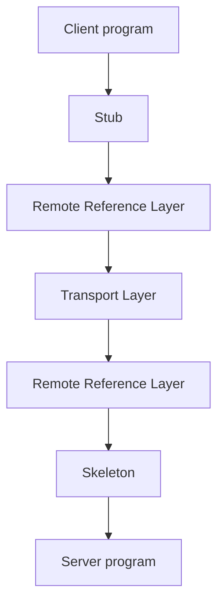

# Java RMI

The concrete realization of [[concepts/remote-invocation|remote invocation]] used in the
module.

## Architecture

**RMI software** is the **software layer between the objects at application level and the
communication and remote-reference module.** It consists of **stubs, dispatcher and
skeleton.**



### Remote Reference Layer

- **Translation of remote and local object references on the basis of a remote object
  table.**
- **Creation of remote references.**

### Stub

- **Proxy object on the client side.**
- **Makes remote method calls transparent for clients.**
- **Marshalling of the arguments, unmarshalling of the return value, sending and receiving.**
- **Behaves like a local object.**
- **Calls are not executed but forwarded to the remote object.**
- **One stub per remote object.**

### Skeleton

- **Proxy object on the server side.**
- **Implements the remote interface.**
- **Unpacking of the call.**
- **Call of the corresponding method of the remote object.**
- **Packing of the result into the answer.**
- **One skeleton class per remote object class.**

> [!exam]
> Note the asymmetry: **one stub per remote *object*, one skeleton class per remote *object
> class*.** The stub carries the identity of a particular object; the skeleton only needs to
> know how to dispatch for a type.

**Stubs and skeletons are generated by the compiler at compile time.**

## Key classes and interfaces

| Type | Role |
|---|---|
| `java.rmi.Remote` | **interface that all remote objects must implement** |
| `java.rmi.RemoteException` | **subclass of `IOException`; remote methods can throw this exception** |
| `java.rmi.server.UnicastRemoteObject` | **classes of remote objects can be subclasses of this class** |
| `java.rmi.RMISecurityManager` | **the security manager determines the rights of loaded classes** |
| `java.rmi.Naming` | **class for accessing the name server** |
| `java.io.Serializable` | **parameters and return values must implement this interface in order to be passed by copy** |

## The remote interface

- **`Remote` is the marker interface that every remote interface extends.**
- **All methods carry `RemoteException` in their `throws` clause.**

> [!warning]
> The source states that "the interface `Remote` is an extension of `Serializable`". **This
> is wrong**, and it contradicts the table above on this very page. `java.rmi.Remote` is an
> empty marker interface that extends nothing. The two interfaces mark *different* things:
> - `Remote` marks an object that stays put and is reached **by reference** through a stub;
> - `Serializable` marks a value that is copied **by value** across the wire.
>
> They are opposites, so one cannot extend the other. See
> [[concepts/distributed-object-model]] for the parameter-passing rules this distinction
> produces.

```java
public interface Address extends Remote {
    public String getName() throws RemoteException;
    // ...
}
```

Parameter-passing rules are in [[concepts/distributed-object-model]].

> [!inference]
> `RemoteException` is a *checked* exception on every method, which means the compiler
> forces the caller to acknowledge that the call may fail in ways a local call cannot. Java
> deliberately refuses full transparency here — exactly the "not all aspects can be made
> transparent" point from [[concepts/remote-invocation]], enforced by the type system.

## Remote classes and exporting

Remote classes **must implement the remote interface**. **Before clients can call remote
methods, the remote objects must be *exported* from the server.** Two possibilities:

1. **The remote class is a subclass of `UnicastRemoteObject`** — such objects are
   **automatically exported on creation.**
2. **The server exports objects explicitly** with a call of **`exportObject`**.

```java
public class AddressListImpl extends UnicastRemoteObject implements AddressList {

    public Address createAddress() throws RemoteException {
        // ...
        return (Address) UnicastRemoteObject.exportObject(addr);
    }

    public void deleteAddress(Address addr) throws RemoteException {
        // ...
        UnicastRemoteObject.unexportObject(addr.getKey());
    }
}
```

## The server program

A server program contains:
- an **initialization part, in which at least one remote object is generated**,
- a **starting point for further communication**,
- the **registration of the object in the registry** — **in address-list management only the
  list must be registered**, because `createAddress` hands back further remote references.

```java
public class AddressListRmiServer {
    // ...
    public void start() {
        Registry registry = null;
        try {
            System.setProperty("java.rmi.server.hostname", host);
            registry = LocateRegistry.createRegistry();
            registry.rebind(serviceName, addressList);
            // ...
        } catch (Exception e) {
            // ...
        }
    }
}
```

## The client program

```java
public class AddressClient {
    public static void main(String args[]) {
        Config cfg = new Config();
        cfg.parse(args);
        try {
            String key = "rmi://" + cfg.getHostname() + ":" + cfg.getPort()
                       + "/" + cfg.getServiceName();
            AddressList al = (AddressList) Naming.lookup(key);
            // ... from here on, al.method() looks like a local call
        } catch (Exception e) {
            // ...
        }
    }
}
```

See [[concepts/rmi-registry]] for the address format and the `Naming` methods.

## Related
- [[concepts/remote-invocation]]
- [[concepts/distributed-object-model]]
- [[concepts/rmi-registry]]
- [[concepts/stubs-and-skeletons]]
- [[concepts/proxy]]
- [[exercises/ex04-rpc-rmi-and-ber]]
- [[chapters/04-remote-invocation]]
