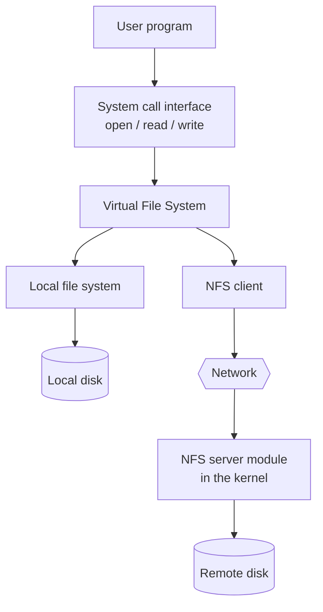
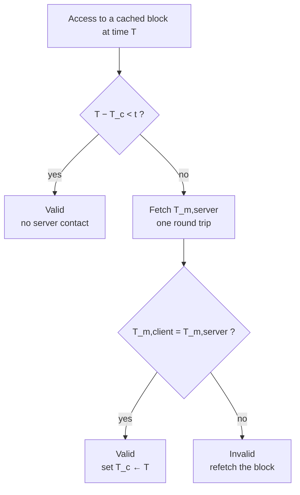

# NFS — Network File System

The worked example of a [[concepts/distributed-file-system]].

## Structure

- the **NFS server module sits in the kernel**
- **user programs can use file operations in the same way for local and remote files**
- **integration happens via the Virtual File System (VFS)**



> [!inference]
> The VFS is the whole trick, and it is an old one: it is an
> [[concepts/interface-definition-language|interface]] that both the local file system and
> the NFS client implement, so the system-call layer never learns which one it is talking
> to. Structurally this is the same device as the
> [[concepts/stubs-and-skeletons|client stub]] in chapter 4 — a local object that satisfies
> the expected interface and forwards. Access transparency is always implemented this way.

## Which transparencies NFS provides

| Transparency | How NFS realizes it |
|---|---|
| **Access** | **clients can perform accesses to local and remote files in the same way** |
| **Location** (*Ortstransparenz*) | **file systems or parts of them are offered for export**; the **client specifies at which point in the local directory the imported file system is mounted** (the **mount point**) |
| **Failure** | named in the summary without elaboration |
| **Concurrency** | named in the summary without elaboration |

> [!warning]
> The summary lists failure and concurrency transparency as headings with nothing under
> them. Treat these as **gaps to fill from the lecture slides**, not as claims that NFS
> provides them — classic NFS is notably weak on both.

## File groups

> [!definition]
> A **file group** (*Dateigruppe*) is a **set of files on one server.**

- **a file system is a file group**
- **a directory exported by NFS is a file group**
- **file groups in a distributed system must be uniquely identifiable**
- **the virtual integration of one file group into another is called *mounting*.**

## The mount service

- **in NFS the mount service process takes over the mounting of remote file systems**
- **on the server there is a file with the names of local file systems that may be
  mounted**
- a **mount point** (*Mount-Punkt*) **indicates the place of the mount in the local file
  system**
- the **automounter manages a table of mount points and references to NFS servers**
- the **automounter transparently takes over the mounting of a remote directory on the
  first access to an empty mount point**

> [!inference]
> Mounting only works because a [[concepts/file-system|directory is just a name-to-ID
> mapping]]. Grafting a remote tree in is a single local edit to one mapping. And the
> automounter is the same pattern as [[concepts/rmi-registry|lazy binding]] in chapter 4:
> resolve the name at first use, not at configuration time.

## NFS client caching

The interesting part, because it is a concrete
[[concepts/file-caching-and-replication|client-cache consistency protocol]].

- **a validity check happens before every access**
- for this, **all blocks in the cache have two timestamps**:

| Timestamp | Meaning |
|---|---|
| `T_c` | the **time at which the cache entry was last checked** |
| `T_m` | the **time at which the block was last modified on the server** |

> [!definition]
> A cache entry is **valid at a time `T`** if
>
> ```text
> (T − T_c < t)   OR   (T_m,client = T_m,server)
> ```
>
> where **`t` is the refresh interval** (*Aktualisierungsintervall*).

- the first disjunct is the **cheap** test: the entry was checked recently enough, so trust
  it without contacting the server
- the second disjunct is the **expensive but exact** test: ask the server for its `T_m` and
  compare
- **`t` is a compromise between consistency and efficiency**
- **on a write access the corresponding block in the cache is marked `dirty`**



> [!inference]
> The `OR` is doing real work. Without the first disjunct, every single access would cost a
> round trip and the client cache would eliminate only disk time — collapsing into the
> [[concepts/file-caching-and-replication|server-cache case]]. Without the second, a stale
> entry could never be noticed before `t` elapsed. Together they give **bounded
> staleness**: a client may read data up to `t` out of date, and never more.

> [!exam]
> Be ready to state the consistency guarantee NFS actually gives: **not** one-copy
> semantics, but *"no client reads data more than `t` out of date"*. Setting `t = 0`
> recovers one-copy semantics at the cost of a round trip per access; setting `t = ∞` gives
> session semantics.

## Related
- [[concepts/distributed-file-system]]
- [[concepts/file-caching-and-replication]]
- [[concepts/stateless-and-stateful-servers]]
- [[concepts/file-system]]
- [[concepts/storage-architectures]]
- [[concepts/transparency]]
- [[chapters/05-distributed-resources-and-synchronization]]
