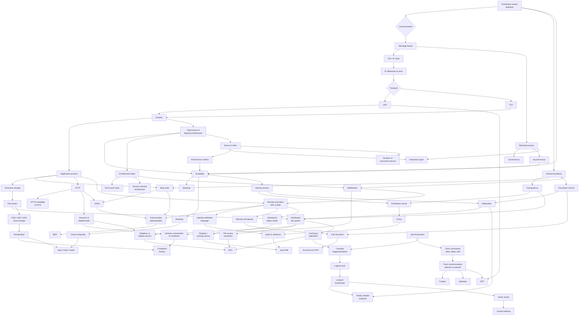

# Distributed Systems (TUHH) — Overview

The course map for the TUHH *Distributed Systems* module. Chapter list, topic dependencies,
and current coverage.

## Chapters

| # | Chapter | Page | Status |
|---|---------|------|--------|
| 1 | Networking and Socket Programming | [[chapters/01-networking-and-sockets]] | solid |
| 2 | Foundations of Distributed Systems | [[chapters/02-foundations-of-distributed-systems]] | solid |
| 3 | Architectures and Web-Based Systems | [[chapters/03-architectures-and-web-systems]] | solid |
| 4 | Remote Invocation (RPC and RMI) | [[chapters/04-remote-invocation]] | solid |
| 5 | Distributed Resources and Synchronization | [[chapters/05-distributed-resources-and-synchronization]] | solid |

> [!inference]
> All five chapters of the module are now ingested. Chapters 1–2 build the vocabulary,
> chapter 3 the structures, chapter 4 the communication mechanism, and chapter 5 resolves
> the one inherent problem the earlier chapters kept deferring: **there is no global
> clock.**

## Topic dependency map

*How the material hangs together. Chapter 1 occupies the left branch, Chapter 2 the right,
Chapter 3 the middle, Chapter 4 below it, and Chapter 5 the two bottom clusters —
storage on one side, time on the other.*

## Recurring threads

These run through the whole module and are worth tracking as more chapters arrive:

- **No global clock** → ordering of events; so far only named as a problem in
  [[concepts/distributed-system]].
- **Independent failures** → [[algorithms/two-phase-commit]] is the first mechanism that
  confronts them, and the first to be shown *blocking*. Chapter 3 shows the same blocking
  weakness again in synchronous [[concepts/replication]]; Chapter 4 turns it into an
  impossibility result in [[concepts/call-semantics]]; Chapter 5 reproduces it a third time
  in [[algorithms/totally-ordered-multicast]], where one crashed computer stalls every
  queue in the system.
- **Heterogeneity** → [[concepts/byte-order]] is the concrete instance;
  [[concepts/middleware]] is the general answer, [[concepts/json]] the application-level
  one, and [[concepts/external-data-representation]] the systematic one. Chapter 5 adds the
  deployment-level answer: ship the environment with the code
  ([[concepts/containers]]).
- **Coordination cost grows with n** → the quantitative core of
  [[concepts/scalability]] and [[concepts/speedup]]; revisited as `r > k·w` in
  [[concepts/replication]], as O(N²) in [[algorithms/totally-ordered-multicast]] and as
  O(n) per message in [[algorithms/vector-clocks]].
- **Coupling** → the organizing axis of [[models/architectural-styles]] and the stated
  motivation for [[concepts/service-oriented-architecture]].
- **Transparency as a bought property** → [[concepts/distribution-server]] and
  [[concepts/proxy]] both purchase [[concepts/transparency]] at the cost of an extra hop and
  a central bottleneck. [[concepts/remote-invocation]] names the **limit**: not all aspects
  can be made transparent. [[concepts/cloud-service-models]] turns it into a dial —
  transparency and control are the same quantity measured from opposite ends.
- **Naming** → promised by [[concepts/middleware]] and
  [[concepts/libraries-frameworks-and-containers|frameworks]], delivered as
  [[concepts/rmi-registry]], and then met twice more in chapter 5: the
  [[models/nfs|NFS mount service]] and the [[concepts/containers|Docker registry]]. The
  same pattern each time — a well-known place mapping a name to a thing you then load.
- **State is never destroyed, only relocated** → [[concepts/sessions-and-statelessness]]
  pushes HTTP session state to the client; [[concepts/stateless-and-stateful-servers]]
  makes the same move for file servers and names the price explicitly. In both cases the
  gain is fault tolerance and the cost is message size.
- **Consistency is bought with copies, and paid for in latency or conflicts** →
  [[concepts/file-access-semantics]] states the trade as a catalogue,
  [[concepts/file-caching-and-replication]] as a set of mechanisms, and [[models/nfs]] as
  a concrete bounded-staleness guarantee.
- **Real time is not what distributed algorithms need** → the chapter-5 punchline. Four
  pages fail to synchronize physical clocks exactly
  ([[concepts/clock-correctness]], [[algorithms/cristians-algorithm]],
  [[algorithms/berkeley-algorithm]]), then [[concepts/causality|order]] is obtained exactly
  and for free by giving up on real time.

## Open questions / gaps

- [[concepts/persistent-data-storage]] is thin (3 lines in the source), although
  [[concepts/file-system]] now picks the thread back up.
- Exercise 1 numbering jumps from 1.4 to 1.8 in the summary — tasks 1.5–1.7 are absent from
  the source. Exercise 4 likewise skips task 4.5, and exercise 5 skips task 5.1 b).
- Peer-to-peer is introduced in [[models/centralized-and-decentralized-architectures]] but
  the source leaves "how do the peers find each other?" unanswered, and nothing in
  chapters 3–5 returns to it. **Still open at the end of the module.**
- A contradiction about whether replication is transparent is flagged and resolved on
  [[concepts/distribution-server]]; re-check against a later source.
- [[models/nfs]] lists **failure transparency** and **concurrency transparency** as
  headings with no content in the summary. These need filling from the lecture slides.
- The second principle of clock correction is missing from the source — see the numbering
  warning on [[concepts/clock-correctness]].
- Chapter 5 presents [[algorithms/totally-ordered-multicast]] and
  [[concepts/causal-ordering]] without ever stating that neither implies the other; the
  comparison table on [[concepts/causal-ordering]] is my synthesis and would be worth
  checking against the slides.
- **All five summary PDFs are now ingested.** Further growth should come from lecture
  slides, exercise sheets not covered by the summaries, or queries filed back into
  `wiki/queries/`.

## Related
- [[index]]
- [[glossary]]
- [[log]]
